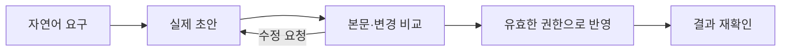

# Agent-Native Tool Design
## Core Laws · Engineering Guide · Human–Agent Collaboration

**개정 기준일: 2026-09-13 · 문서 버전: 3.1 · 상태: 단일 정본(Canonical) · 설계 가이드, 구현 인증 아님**

> 에이전트에는 화면 조작의 모방이 아니라, 식별 가능한 상태·허용된 의미 단위 행동·실제 결과를 확인할 근거를 제공한다.
>
> 사람과 에이전트가 함께 쓸 때는 **도메인 상태와 변경의 의미를 공유하고, 관찰·조작 인터페이스는 각자에게 맞춘다.**

---

<a id="reading"></a>
## 읽는 방법과 근거의 경계

첨부 원문의 Identity, Law 1–20, 여섯 가지 interface surface, 설계 검사법을 유지하면서 구현 규칙과 협업 계약을 보강했다. 이 버전은 **설계 원칙, 구현 규칙, capability 명세 양식, 평가 양식, 계약 예제, 검증 기록을 한 파일에 통합한 단일 정본**이다. 아래 출처 표기는 원문과 외부 자료, 이 문서의 제안을 구분한다.

| 표기 | 의미 |
|---|---|
| `[ORIGINAL]` | 첨부 원문의 관점·주장. 별도 출처 검증을 뜻하지 않는다. |
| `[SPEC]` | 확인한 공개 명세의 해당 버전 규정. 지원 제품·구현 범위는 별도다. |
| `[DOC]` | 공급자의 공개 문서·기술 설명. 제품별 제약을 포함한다. |
| `[ROADMAP]` | 계획·논의 중인 방향. 배포되었다는 뜻이 아니다. |
| `[RESEARCH]` | 논문·평가가 조사한 범위의 결과. 보편적인 우월성 보장은 아니다. |
| `[DESIGN]` | 원문과 연구를 바탕으로 이 가이드가 제안하는 설계 규칙. |
| `[UNKNOWN]` / `[UNVERIFIED]` | 확인할 수 없거나 실제 환경 검증이 없는 항목. |
| `[ASSUMPTION]` | 예제를 성립시키기 위해 정한 조건. 제품에 자동 적용하지 않는다. |

**이 문서의 MUST / SHOULD / MAY는 프로젝트 설계를 위한 규범이다.** 각각 필수 / 기본 권장 / 선택을 뜻한다. 인용된 프로토콜의 MUST와 혼동하지 않는다. 별도 표기가 없는 규칙·예제·체크리스트는 `[DESIGN]`이다.

기존 프로토콜·연구 주장은 공개 자료를 2026-09-09에 확인한 범위에 한정한다. 6.5–6.9의 UI/AX와 시각화 보강은 2026-09-13에 별도로 조사했으며 기존 출처 전체를 재검증한 것으로 해석하지 않는다. 웹페이지의 조회일과 발행일을 구분한다. SDK·브라우저·호스트·모델의 실제 호환성은 이 문서만으로 보증하지 않는다.

### 목차

- [0. 정체성과 사람·에이전트의 차이](#identity)
- [1. 최신 자료가 바꾸는 판단](#current-evidence)
- [2. 공통 아키텍처와 최소 적용 수준](#architecture)
- [3. Law 1–20: 에이전트 도구 설계 규칙](#laws)
- [4. 실제로 만드는 순서](#workflow)
- [5. 계약·오류·실행·복구 모델](#contracts)
- [6. 사람과 에이전트가 함께 쓰는 설계](#collaboration)
- [6.5–6.9. 자연어 작성·공유 작업 화면·시각화·완료 판정](#visual-workspace)
- [시각화 방법·도구 비교·실제 예제](Agent-Native-Visualization-Guide.md)
- [7. MCP·CLI·SDK·WebMCP·UI 선택](#adapters)
- [8. 평가와 출시 판정](#evaluation)
- [9. 원문 개정 기록](#audit)
- [10. 근거 자료와 한계](#sources)
- [11. 구현·리뷰 체크리스트](#operational-checklist)
- [12. Capability Specification 템플릿](#capability-template)
- [13. Evaluation 템플릿](#evaluation-template)
- [14. 구조화 계약 예제](#contract-example)
- [15. 이 문서의 검증 기록](#document-validation)

---

<a id="identity"></a>
# 0. Identity — 무엇을 만드는가

## 0.1 Agent-native tool의 정의

`[ORIGINAL → DESIGN]` Agent-native tool은 확률적으로 추론하는 실행 주체가 외부 세계를 다루도록 설계된 **명시적 환경 인터페이스**다.

```text
Intent
→ Discover: 필요한 능력 찾기
→ Inspect: 관련 상태와 제약 읽기
→ Plan: 의미 있는 변경 제안
→ Authorize: 외부 정책으로 실행 가능 여부 결정
→ Act: 전제조건 아래 실행
→ Observe: 실제 결과 관찰
→ Verify: 목표·불변식 확인
→ Recover: 실패·불확실성·중단 처리
```

모든 요청이 이 단계를 별도 네트워크 호출로 거칠 필요는 없다. 작은 읽기 도구에는 한 호출로 충분하다. 핵심은 중요한 판단·권한·부수효과·증거가 어디에 속하는지 설명할 수 있는 것이다.

**정확한 계약은 세계가 결정적이라는 뜻이 아니다.** 외부 API, 동시 사용자, 시간, 모델, 네트워크는 달라질 수 있다. 도구는 가능한 상태와 전이, 관찰의 시점, 부수효과의 범위, 불확실한 결과를 숨기지 않아야 한다.

Anthropic의 도구 설계 지침과 SWE-agent 연구는 에이전트의 행동 품질이 도구 인터페이스의 구성과 표현에 영향을 받음을 보여준다. 이것이 특정 UI나 API 형식의 보편적 우월성을 뜻하지는 않는다. [S01](#source-s01) [S02](#source-s02)

## 0.2 사람이 쓰기 좋은 것과 에이전트가 쓰기 좋은 것

다음은 능력의 절대적인 구분이 아니라 **기본 설계의 무게중심**이다. 사람도 구조화 데이터를 읽고, 에이전트도 시각 정보를 활용한다.

| 설계 문제 | 사람에게 유리한 표현 | 에이전트에게 유리한 표현 | 함께 쓸 때의 계약 |
|---|---|---|---|
| 현재 상황 이해 | 배치·미리보기·강조·요약 | 관련 상태·관계·제약·revision | 같은 대상과 같은 상태 버전을 가리킨다. |
| 대상 선택 | 검색 결과·직접 선택 | 검색 후 stable ID로 지정 | 이름은 이해용, ID는 실행용이다. |
| 기능 찾기 | 메뉴·검색·추천 | 제한된 capability 검색·상세 계약 | 이름·의미·권한 조건이 서로 어긋나지 않는다. |
| 변경 | 직접 조작·폼·단축키 | 명시적 의미 단위 명령 | 최종 변경은 공통 도메인 규칙을 통과한다. |
| 위험 판단 | 실제 diff·영향 범위·승인 | 효과·전제조건·정책 결과 | 승인은 실행될 정확한 변경에 결속된다. |
| 진행 확인 | 상태 표시·활동 이력 | operation/task 상태·이벤트 | 같은 실행 ID와 실제 진행 사실을 사용한다. |
| 완료 판단 | 변경 화면·결과 설명 | receipt·후속 관찰·검증 결과 | 설명은 근거에서 파생된다. |
| 실패 처리 | 수정·취소·다시 시도 | 분류된 오류·안전한 복구 행동 | 취소 요청과 원상복구를 구분한다. |
| 주도권 변경 | 멈춤·직접 수정·인계 | 실행 권한·intent version·stale 차단 | 이전 의도의 지연 실행이 새 작업을 덮지 않는다. |

좋은 협업 도구는 사람에게 JSON을 읽도록 강요하지 않고, 에이전트에게 메뉴를 따라 클릭하도록 강요하지 않는다. **공유해야 할 것은 화면 모양이 아니라 사실과 변경의 의미다.**

## 0.3 세 가지 혼동을 피한다

**Agent-native ≠ MCP server.** MCP, CLI, SDK, REST는 연결 방식이다. 도메인 계약이 나쁘면 어떤 연결 방식을 붙여도 나쁜 도구다.

**Agent-native ≠ 자율 실행 극대화.** 읽기만 가능하거나, 변경 제안만 만들거나, 승인 이후에만 실행하는 도구도 충분히 agent-native일 수 있다.

**사람·에이전트 공용 ≠ 동일 권한.** 같은 리소스와 변경 의미를 사용하더라도 사람과 에이전트의 역할·범위·위임·만료 조건은 달라야 할 수 있다.

---

<a id="current-evidence"></a>
# 1. 최신 자료가 바꾸는 판단

## 1.1 2026-09-09 기준 확인한 변화

| 자료·날짜 | 확인된 내용과 상태 | 이 가이드에 반영한 판단 |
|---|---|---|
| OpenAI 변경 이력, 2026-09-08 | Prompt Cache Diagnostics 일반 제공 기록. [DOC] [S12](#source-s12) | context 비용을 토큰 수만이 아니라 cache hit와 재사용 조건까지 측정한다. |
| WebMCP, 2026-09-04 | 같은 웹 인터페이스에서 사람과 에이전트가 공유 맥락을 유지하는 API 초안. W3C 표준이 아니다. [SPEC: 초안] [S15](#source-s15) | 협업용 화면에 의미 단위 도구를 병행하는 방식을 별도로 설계한다. |
| OpenAI 변경 이력, 2026-09-03 | async tool calling과 mid-turn steering 공개 기록. [DOC] [S10](#source-s10) [S11](#source-s11) [S12](#source-s12) | 병렬 진행·방향 수정·실행 취소를 하나의 기능으로 취급하지 않는다. |
| Chrome WebMCP 보안 문서, 2026-09-01 수정 | 비신뢰 콘텐츠와 consequential action 힌트 등 안전 설계 지침. 잠정 문서다. [DOC] [S16](#source-s16) | 메타데이터는 설명이며, 권한과 입력 검증은 실행 경계에서 강제한다. |
| MCP 로드맵, 2026-08-22 수정 | progressive discovery, 위임·workload identity, 결과·작업 모델 개선 방향. [ROADMAP] [S05](#source-s05) | 미래 방향과 현재 상호운용 가능한 기능을 구분한다. |
| MCP, 2026-07-28 | 프로토콜 세션·초기화 변경, application handle 명시, Tasks의 확장 이동 등. [SPEC] [S03](#source-s03) | 프로토콜 상태, 제품 작업 상태, 모델 대화 상태를 분리한다. |
| MM-ToolSandBox, 2026-07-13 초판·2026-08-21 v2 | 멀티모달·상태 의존 도구 사용과 사용자 목표 변경을 다루는 평가 연구. [RESEARCH] [S25](#source-s25) | 텍스트-only 성공률만으로 시각 도구와 협업 도구를 평가하지 않는다. |
| HAS-Bench, 2026-07-05 | 사람 참여를 clarification·feedback·control 등으로 구분해 평가하는 연구. [RESEARCH] [S26](#source-s26) | 질문, 의견, 승인, 중단·인계를 별도 제품 동작으로 설계한다. |

**최신 논문이나 기능의 존재는 도입 의무가 아니다.** 상태·권한·실패 모델이 단순한 제품에는 일반 SDK의 typed function만으로 충분하다.

## 1.2 원문의 최신 기술 주장 검증 결과

원문의 MCP 2026-07-28, 2026-08-22 로드맵, Anthropic brain/hands/session 분리 언급은 공개 근거를 확인했다. 다음 제한을 추가했다.

- MCP의 **Tasks는 현재 공식 확장**이다. 모든 MCP 구현이 반드시 제공하는 기본 기능처럼 쓰지 않는다. [S03](#source-s03)
- progressive discovery는 구현 패턴이면서 공급자 기능이기도 하지만, MCP 로드맵 항목 전체가 이미 배포된 공통 계약은 아니다. [S05](#source-s05) [S08](#source-s08)
- MCP의 구조화 결과와 LLM 공급자의 strict function schema는 같은 계층이 아니다. 서로 다른 지원 범위를 adapter에서 처리한다. [S04](#source-s04) [S07](#source-s07)
- 코드 실행으로 중간 결과를 처리하는 방식은 유용할 수 있지만, 항상 typed tool보다 좋은 것은 아니다. [S06](#source-s06) [S09](#source-s09)

---

<a id="architecture"></a>
# 2. 공통 아키텍처와 최소 적용 수준

## 2.1 하나의 의미 모델, 두 개의 인터페이스

```text
사람                                       에이전트
 │                                           │
 ▼                                           ▼
시각 UI / 직접 조작 / 검토                  Discovery / State / Typed Actions
 │                                           │
 └────────── 명시적 도메인 명령 ────────────────┘
                         │
                         ▼
             Application Service / Command Boundary
             입력 해석 · 의미 검증 · 권한 · 전제조건
                         │
                         ▼
              Domain Transition + Effect Executor
                         │
                         ▼
             Authoritative State / External Systems
                         │
                         ▼
               Result / Operation / Evidence
                  │                    │
                  ▼                    ▼
            사람용 표현             에이전트용 표현
```

이 도식은 독립 서버·서비스를 각각 만들라는 지시가 아니다. 한 프로세스의 함수와 모듈 경계로도 구현할 수 있다. 읽기는 필요한 권한 검사를 거쳐 직접 조회할 수 있다. 모든 요청을 불필요한 command bus에 태우지 않는다.

**단일 진실은 material fact마다 하나의 authoritative owner가 있다는 뜻이다.** 모든 데이터를 한 테이블이나 전역 store로 합친다는 뜻이 아니다. 외부 서비스가 실제 발송·배포·결제 상태의 주인일 수 있으며, 로컬 기록은 그 사실에 대한 관찰일 수 있다.

## 2.2 무엇의 주인이 누구인가

| 항목 | 권장 소유자 | 해서는 안 되는 일 |
|---|---|---|
| 목표·사용자 제약 | 사용자 입력을 수용한 작업/의도 상태 | 모델의 기억만으로 최신 목표를 결정한다. |
| 업무 상태·불변식 | 해당 도메인 또는 외부 authoritative service | UI와 agent adapter가 각각 업무 상태를 갱신한다. |
| 실행 권한 | 인증·위임·정책 경계 | 모델이 `role: admin`을 써서 권한을 만든다. |
| 제안·승인 결속 | proposal/approval 책임 영역 | 채팅의 “좋아요”를 무기한 포괄 승인으로 바꾼다. |
| 실행·중복 억제·진행 | operation executor/기록 | 대화 메시지를 실행 원장 대신 사용한다. |
| 실제 효과의 근거 | 결과를 관찰한 시스템 | 계획의 설명을 완료 증거로 사용한다. |
| 화면 선택·확대·열린 패널 | UI | 모든 일시적 UI 상태를 영속 도메인 상태로 승격한다. |
| 대화 요약·모델 context | agent harness | 요약을 리소스의 최신 상태로 취급한다. |

원문의 brain/hands/state 분리는 유지한다. Anthropic의 Managed Agents 설명도 추론, 실행 환경, 지속되는 세션 기록을 분리한다. 다만 이것이 특정 공급자의 전체 구조를 복제해야 한다는 뜻은 아니다. [S14](#source-s14)

## 2.3 위험에 비례해 계약을 추가한다

| 적용 수준 | 대상 예 | 필요한 계약 |
|---|---|---|
| A. 제한된 읽기 | 공개 문서 검색·상태 확인 | 명확한 입력/결과, 출처·시점, 범위·크기 제한, 구조화 오류 |
| B. 되돌릴 수 있는 로컬 변경 | 문서 제목 수정·객체 위치 변경 | A + revision/전제조건, 효과 보고, 재시도 의미, 필요한 경우 undo |
| C. 외부·중대한 변경 | 메시지 발송·배포·영구 삭제 | B + 좁은 위임, 정책/승인, operation identity, 중복 억제, 불확실 결과 처리 |
| D. 장기·동시·협업 작업 | 배치·백그라운드 작업·사람 동시 편집 | 해당 수준 + lifecycle, 재접속 관찰, 취소 의미, stale 작업 차단, 인계 |

분류는 보안 등급 표준이 아닌 설계 편의다. 읽기라도 개인정보 유출·고비용 조회·원격 접근 위험이 있으면 추가 제한이 필요하다. 모든 capability에 거대한 공통 envelope나 승인 단계를 강제하지 않는다. [S13](#source-s13)

---

<a id="laws"></a>
# 3. Law 1–20 — 에이전트 도구 설계 규칙

각 법칙은 원문의 식별자를 유지한다. 굵은 문장은 이 가이드의 핵심 설계 규칙이다.

<a id="law-01"></a>
## Law 1 — Expose the Domain, Not the Human Application

**MUST: 먼저 실제로 다루는 대상·불변식·변경을 정의하고, UI나 endpoint 이름은 나중에 선택한다.**

`Photoshop → 메뉴 클릭`보다 `image → layer → transform`, `IDE → 버튼`보다 `source → symbol → rename`을 우선 검토한다. 기존 제품의 도메인 API가 올바르면 재사용하고 새 추상화를 얹지 않는다.

업무 로직은 공통 domain/application service에 둔다. UI는 제스처를 명령으로 바꾸고, 에이전트 adapter는 구조화 인자를 같은 의미의 명령으로 바꾼다. 사람이 직접 조작한 경우에도 불변식을 우회하지 않는다.

**검사:** 같은 변경을 UI·CLI·agent에서 실행했을 때 허용 조건과 결과 의미가 같은가? 달라야 한다면 역할·권한 차이로 설명되는가?

**예외:** 실제 대상이 화면 픽셀·시각 배치라면 이미지와 좌표도 도메인이다. 구조화 인터페이스를 만들기 위해 시각적 사실을 제거하지 않는다.

<a id="law-02"></a>
## Law 2 — Expose State, Not Merely Its Rendering

**MUST: 판단에 필요한 상태를 읽을 수 있어야 한다. 상태라고 부르는 정보의 기준 시점과 완전성을 명시한다.**

기본 observation은 대상 ID, 관련 값, 관계·제약, revision 또는 관찰 시점, 누락·redaction·truncation 여부를 담는다. 실제로 없는 revision을 만들어 최신성을 보장한 것처럼 표현하지 않는다.

검색 결과와 상세 읽기는 용도가 다르다. 검색 요약만으로 변경 전제조건을 확정하지 않는다. indexed result와 authoritative read의 차이도 드러낸다.

이미지·레이아웃 도구에는 가능한 scene metadata와 실제 render를 함께 제공한다. 메타데이터는 픽셀 결함을 증명하지 못하며, screenshot은 보이지 않는 데이터 무결성을 증명하지 못한다. 멀티모달 도구의 평가는 이 차이를 포함해야 한다. [S25](#source-s25)

**검사:** “지금”이라는 응답이 실제로 어느 시점·버전의 어떤 부분을 뜻하는가?

<a id="law-03"></a>
## Law 3 — The Unit of Action Is a Bounded Semantic Transition

**MUST: 크기가 아니라 의미·권한·원자성·실패·검증 경계로 도구 단위를 정한다.**

원문의 “가장 작은 단위”와 “가장 큰 독립 검증 단위”를 다음 기준으로 통일한다.

> 하나의 명확한 의도를 처리하되, 서로 다른 승인이나 복구가 필요한 중요한 결정을 숨기지 않는 단위.

결정적 glue는 내부로 묶을 수 있다. 예를 들어 `rename_symbol`은 선언·참조 수정과 파싱 확인을 묶을 수 있다. 반면 `resolve_customer_problem`이 환불, 계약 변경, 메일 발송을 임의로 수행한다면 권한과 부수효과 경계가 과도하게 합쳐진 것이다.

| 묶어도 되는 경우 | 나누어야 하는 경우 |
|---|---|
| 동일 의도·동일 권한·명확한 전제조건 | 다음 단계에 새로운 사용자 판단이 필요하다. |
| 내부 순서가 결정적이고 검증 가능 | 승인 대상·외부 효과·복구 방식이 달라진다. |
| 원자성이 있거나 partial semantics가 명시됨 | 실패한 부분과 성공한 부분을 식별할 수 없다. |

반복되는 deterministic glue를 의미 단위 도구로 묶는 패턴은 공급자의 도구 설계 지침에서도 제안된다. 효과는 실제 workload에서 평가한다. [S01](#source-s01)

<a id="law-04"></a>
## Law 4 — Stable Identity Beats Position

**MUST: 대상은 실행 가능한 ID로 지정하고, 모델에는 이해 가능한 이름·유형을 함께 보여준다.**

```json
{
  "id": "document_12",
  "name": "출시 계획",
  "kind": "document",
  "revision": "rev_018"
}
```

`세 번째 항목`, `현재 탭`, `왼쪽 이미지`를 장기간 안정적인 참조로 사용하지 않는다. UI selection을 사용할 때도 선택된 대상의 ID와 기준 상태를 명시적으로 전달한다.

ID의 범위, lifetime, 삭제·복원·복제 시 의미를 정의한다. opaque revision은 정수처럼 비교하지 않는다. 서버가 정한 동등성 규칙을 사용한다.

**보안:** ID·URI·task handle을 알고 있다는 사실은 접근 권한이 아니다. 모든 해석·조회·변경은 올바른 사용자·tenant·scope에 결속한다. [S13](#source-s13)

<a id="law-05"></a>
## Law 5 — Discovery Replaces Exhaustive Navigation

**SHOULD: 작은 고정 집합은 직접 제공하고, 큰 capability 집합은 검색→상세 계약→실행으로 노출한다.**

discovery 결과에는 ID, 짧은 용도, 사용하지 말아야 할 조건, 효과 유형, 상세 계약 참조가 필요하다. 실행 전에 인자와 결과 계약을 확인할 수 있어야 한다.

검색 결과가 없다고 capability가 절대 존재하지 않는다고 단정하지 않는다. catalog 범위, 권한 필터, 검색 불완전성 여부를 알린다. 유사 도구를 충분히 구분할 수 있는 설명과 counterexample을 작성한다.

동적 catalog는 contract version을 가져야 한다. 발견 후 내용이 바뀌면 변경된 계약으로 몰래 실행하지 않는다. 접근 가능한 도구만 노출하는 것은 유용하지만, 숨김 자체가 authorization은 아니다.

MCP 로드맵의 discovery 방향과 공급자의 이미 제공되는 tool-search 기능을 구분한다. 도구가 적은데 검색 호출을 강제하면 오히려 비용이 늘 수 있다. [S05](#source-s05) [S08](#source-s08) [S29](#source-s29)

<a id="law-06"></a>
## Law 6 — Context Must Be Addressable, Not Preloaded

**MUST: 필요한 부분을 조회할 수 있게 하고, 잘린 결과를 전체 결과처럼 표현하지 않는다.**

읽기 도구는 문제에 맞는 search, filter, projection, range, pagination, aggregation을 제공한다. 전부 구현하라는 뜻은 아니다. limit의 단위, 최대값, 기본값, 정렬 기준, cursor 만료와 snapshot 의미를 명시한다.

큰 payload는 접근 제어된 artifact handle과 요약·크기·형식·필요한 무결성 정보를 반환한다. handle의 유효기간과 다시 읽는 방법을 제공한다. 요약은 원본 대신 authoritative evidence가 되지 않는다.

`없음`, `접근 불가`, `아직 조회하지 않음`, `잘림`, `알 수 없음`을 같은 빈 배열로 숨기지 않는다. 민감한 객체의 존재를 공개하면 안 되는 경우에는 보안 정책이 허용하는 응답으로 통일하되, 이를 문서화한다.

**검사:** 다음 판단에 쓰이지 않는 필드가 context 대부분을 차지하는가? 전체 token 감소와 함께 도구 선택·최종 성공률이 유지되는가?

<a id="law-07"></a>
## Law 7 — Use an Action Language When Composition Dominates

**MAY: 필터·반복·조인 같은 결정적 조합이 주된 부담일 때 code/query/DSL을 제공한다.**

중간 데이터를 모델로 매번 왕복시키지 않고 실행 환경에서 처리할 수 있다. 단일 동작, 중요한 승인, 새 의미 판단이 필요한 분기는 typed call이 더 적합할 수 있다. [S06](#source-s06) [S09](#source-s09)

코드 경로도 같은 capability·scope·budget·I/O 정책을 통과해야 한다. typed tool에서는 금지한 변경을 shell이나 SDK로 우회할 수 있다면 통제 경계가 깨진 것이다. 네트워크·파일·프로세스 접근은 실제 sandbox 정책으로 제한한다.

**제품별 차이:** OpenAI의 현재 programmatic tool calling은 격리된 JavaScript 실행과 노출된 도구 조합을 제공하며, 일반 Node.js·임의 네트워크·일반 파일시스템 환경과 동일하지 않다. 다른 공급자의 code execution과 동작을 섞어 가정하지 않는다. [S09](#source-s09)

**검사:** 이 언어가 필요한 조합 능력을 추가하는가, 아니면 모든 통제를 우회하는 또 하나의 실행기를 만드는가?

<a id="law-08"></a>
## Law 8 — Make Effects Explicit Before Execution

**MUST: 변경 가능한 대상·외부 전달·비용·삭제·가역성·부분 성공의 의미를 실행 전에 정의한다.**

도구 이름의 `safe`, `preview`, `read`만으로 효과를 추정하지 않는다. preview가 저장·예약·청구를 한다면 그 효과도 공개한다. 단순 조회도 비밀을 반환하거나 외부로 전송할 수 있다.

공급자와 프로토콜의 annotation은 host가 판단하는 힌트다. 백엔드 권한 검사, 리소스 제한, egress 제한, 승인 결속을 대신하지 않는다. MCP와 WebMCP의 annotation 이름도 동일하다고 가정하지 않는다. [S04](#source-s04) [S13](#source-s13) [S16](#source-s16)

**검사:** 도구 설명을 모델이 잘못 이해하거나 무시해도, 실행기는 허용 범위를 넘는 실제 효과를 거부하는가?

<a id="law-09"></a>
## Law 9 — Authority Must Be External to Reasoning

**MUST: 인증 주체·위임·scope·만료·정책은 신뢰된 실행 경계에서 결정하고 강제한다.**

모델은 목표를 위한 행동을 제안한다. 모델 출력의 `approved: true`, `role: admin`, `risk: low`는 권한 증거가 아니다. 필요한 권한과 실제 보유 권한을 분리한다.

자격 증명·승인 증표·tenant binding은 가능한 한 host가 주입한다. 모델에게 비밀을 인자로 생성하거나 복사하도록 요구하지 않는다. 읽기·검색·진행 조회·artifact 다운로드에도 권한을 적용한다.

허용된 범위 안에서도 잘못된 대상을 수정할 수 있다. 따라서 least privilege 외에 목표·대상·변경의 결속과 필요한 검토를 유지한다. prompt injection 분류기나 “지시를 무시하지 말 것”이라는 문장만으로 이 경계를 만들 수는 없다. MCP 보안 지침은 confused deputy, token passthrough, SSRF, handle hijacking 등을 별도 위험으로 다룬다. [S13](#source-s13)

**검사:** 악성 tool result가 다른 tenant의 데이터를 읽거나 외부 주소로 보내라고 요구해도 시스템이 이를 차단하는가?

<a id="law-10"></a>
## Law 10 — Preconditions Must Be Explicit and Enforced at Commit

**MUST: 관찰한 상태가 전제인 변경은 그 전제가 실제 변경 시점에도 성립하는지 검사한다.**

`expected_revision`, 상태 조건, 객체 존재, 불변식, 필요한 policy version 등을 사용한다. 단순히 실행 직전에 읽고 그 뒤 무조건 쓰는 방식은 사이의 경쟁 상태를 막지 못한다. revision 비교와 변경을 가능한 동일한 원자적 경계에서 처리한다.

HTTP 기반이면 리소스 의미에 맞게 `If-Match` 같은 조건부 요청을 적용할 수 있다. 이것은 lost update 방지 수단이지 전체 업무 트랜잭션의 자동 보장이 아니다. [S19](#source-s19)

충돌은 기존 요청을 맹목적으로 재시도하라는 신호가 아니다. 새 상태를 읽고 변경 의도가 여전히 유효한지 판단한 뒤, 필요한 제안·승인을 다시 만든다.

**예외:** 현재 상태와 무관한 append나 서버가 정확한 재해석 규칙을 보장하는 연산은 별도 revision 없이 안전할 수 있다. 그 안전 조건을 계약에 적는다. 불필요한 전역 revision으로 무관한 변경까지 충돌시키지 않는다.

<a id="law-11"></a>
## Law 11 — Evidence Is Part of the Mutation Result

**MUST: 중요한 변경은 실제로 확인된 효과를 보고한다. `success: true`만으로 완료를 표현하지 않는다.**

결과에는 요청·실행 식별자, 대상, 효과 상태, 바뀐 값 또는 변경 참조, 확인 가능한 revision/외부 receipt가 필요하다. 적용할 필요가 없었던 `no_change`와 새 변경을 적용한 `applied`도 구분한다.

`accepted`는 작업 수락, `applied`는 알려진 효과의 적용, `verified`는 별도 검증의 판정이다. API가 수락했다고 업무 목표가 달성된 것은 아니다. 비동기 발송 API의 접수 receipt는 수신자의 수신·열람 증거가 아니다.

receipt에는 확인되지 않은 사실을 넣지 않는다. 내부 실행 로그는 좋은 증거일 수 있지만 외부 시스템 상태를 대신하지 못할 수 있다. hash는 특정 bytes의 동일성을 확인할 뿐, 그 bytes가 사용자의 목표를 만족한다는 보증은 아니다.

**검사:** 호출 직후 대화가 사라져도 어떤 대상에 어떤 효과가 있었는지 다시 조회할 수 있는가?

<a id="law-12"></a>
## Law 12 — Verification Must Test the Outcome

**MUST: 완료 기준을 사전에 정의하고, 실행기의 자기 보고와 구분되는 관찰로 중요한 결과를 확인한다.**

여기서 독립성은 반드시 두 번째 모델·서버를 도입한다는 뜻이 아니다. 같은 오류를 그대로 반복하지 않는 관찰·검증 경로가 필요하다는 뜻이다.

| 변경 | 검증할 사실 | 충분하지 않은 주장 |
|---|---|---|
| 소스 수정 | 파싱·빌드·관련 회귀·요구 동작 | patch 적용 성공 |
| 데이터 변경 | authoritative read와 도메인 불변식 | write 함수 정상 반환 |
| 배포 | 대상 revision과 필요한 실제 health | deploy job 종료 |
| 이미지 변환 | 구조 조건과 render 결과 | 좌표 JSON 수정 |
| 문서 생성 | 구조·필수 내용·상호 참조 | 파일이 존재함 |

검증 결과는 `passed`, `failed`, `inconclusive`, `not_run`을 구분한다. eventual consistency 때문에 관찰이 늦는 경우에는 허용된 확인 기간과 재관찰 규칙을 사용한다. 모르는 상태를 성공이나 확정 실패로 바꾸지 않는다.

agent eval 지침과 τ-bench는 마지막 자연어 답변과 실제 환경의 outcome을 구분한다. 이 문서는 그 구분을 제품의 완료 계약에도 적용한다. [S21](#source-s21) [S22](#source-s22)

<a id="law-13"></a>
## Law 13 — Failure Must Be Actionable

**MUST: 실패 코드는 현재 알려진 효과와 안전한 다음 행동을 함께 설명한다.**

`INVALID_INPUT`, `NOT_FOUND`, `CONFLICT`, `PERMISSION_DENIED`, `RATE_LIMITED`, `TEMPORARY_FAILURE`, `PARTIAL_EFFECT`, `UNKNOWN_OUTCOME`처럼 호출자가 행동을 달리해야 하는 경우를 구분한다.

`retryable: true` 하나로는 부족하다. **동일 요청 재시도**, **조건을 바꾼 새 요청**, **상태 조회**, **새 승인**, **운영자 확인**을 구분한다. 오류 메시지에 credential, 내부 경로, 다른 tenant의 데이터를 넣지 않는다.

아래는 오류 상세의 예이며, 전체 tool response envelope는 아니다.

```json
{
  "code": "CONFLICT",
  "effect_status": "not_applied",
  "target_id": "document_12",
  "expected_revision": "rev_018",
  "actual_revision": "rev_021",
  "retry_same_request": false,
  "next_action": "reinspect_and_replan"
}
```

**검사:** 모델이 문장을 추측하지 않고도 안전한 다음 행동을 고를 수 있는가? 권한 없는 호출자에게 `actual_revision`을 보여줘도 되는가?

<a id="law-14"></a>
## Law 14 — Recovery Is a Primitive

**MUST: 중요한 변경은 응답 유실·중복 요청·부분 성공 이후의 처리 규칙을 가진다.**

중복 억제에는 operation identity, idempotency scope, 같은 키의 payload 결속, 보존 기간, 동시 재시도 처리가 필요하다. UUID를 붙였다는 사실만으로 exactly-once 효과가 생기지 않는다.

동일 의도의 재시도는 기존 operation/key와 연결한다. 타임아웃 직후 새 키를 발급해 같은 외부 효과를 다시 요청하지 않는다. 원격 서비스가 중복 억제·상태 조회를 제공하지 않는다면 결과가 끝내 `unknown`일 수 있다. 이를 명시하고 대조·수동 확인 경로를 제공한다.

Stripe 문서는 같은 키의 결과 재사용, 인자 불일치, 보존 기간에 대한 구체적인 계약 사례다. 해당 서비스의 시간값과 오류 저장 규칙을 모든 도구의 보편 규칙으로 복제하지 않는다. [S20](#source-s20)

**구분:** retry는 재호출, rollback은 보장된 경계 안에서의 취소, compensation은 이미 생긴 효과를 상쇄하는 새로운 행동이다. compensation도 권한이 필요하고 실패할 수 있다.

<a id="law-15"></a>
## Law 15 — Long-Running Work Is a Resource

**SHOULD: 수명·중단·재관찰이 중요한 작업은 기다리는 한 호출이 아니라 식별 가능한 operation/task로 노출한다.**

start의 성공은 작업 완료가 아니다. 상태 조회, 마지막 관찰 시점, 결과·오류, 만료·보존 조건, 취소 요청과 실제 중단의 차이를 정의한다. 상태 변경을 이벤트로 제공한다면 누락·중복·순서 역전·재접속의 의미를 정한다. 이벤트 스트림이 끊겨도 필요한 최종 상태를 조회할 수 있어야 한다.

진행률을 계산할 근거가 없으면 단계와 처리된 항목 수를 보여준다. 그럴듯한 퍼센트를 만들지 않는다. progress 알림은 최종 receipt를 대신하지 않는다.

MCP Tasks는 버전이 있는 확장이고, OpenAI async tool calling은 모델이 독립 작업을 계속하도록 하는 API 기능이다. 둘 다 제품의 실행 원장·재시도 안전성·권한 회수를 자동으로 구현해 주지는 않는다. [S03](#source-s03) [S10](#source-s10)

<a id="law-16"></a>
## Law 16 — Relevant Session State Must Be Addressable

**MUST: 다음 판단·변경에 영향을 주는 상태는 명시적으로 참조하거나 신뢰된 context binding으로 전달한다.**

`last_file`, `current_account`, `previous_tool_result` 같은 숨은 상태에 변경 대상을 맡기지 않는다. 필요한 경우 workspace, resource, draft, proposal, operation, cursor, intent version을 명시한다.

다만 “세션을 전부 없애라”는 의미가 아니다. UI의 편집 세션, 작업 진행, 인증, 모델 대화는 각각 필요할 수 있다. **프로토콜 연결 상태와 제품의 의미 상태를 혼동하지 않는 것**이 목적이다.

MCP 2026-07-28의 프로토콜 세션 제거는 애플리케이션 상태의 제거가 아니다. 교차 호출에 필요한 상태는 명시적 handle로 모델링한다. [S03](#source-s03)

**검사:** 새 프로세스·다른 클라이언트가 허용된 식별자와 권한으로 현재 상태를 이해하고 안전하게 이어갈 수 있는가?

<a id="law-17"></a>
## Law 17 — Separate Reasoning, Execution, and Authoritative State

**MUST: 모델의 제안, 실행 통제, 실제 사실의 소유권을 구분한다.**

reasoning은 계획을 생성한다. execution은 제약 안에서 부수효과를 실행한다. authoritative state는 실제 세계의 상태 또는 그 상태를 확인할 권위 있는 시스템이다. context summary는 그 사실의 복사·요약일 뿐이다.

모델 교체가 도메인 불변식을 바꾸지 않아야 한다. MCP server 교체가 승인 의미를 바꾸지 않아야 한다. UI 재시작이 외부 작업을 중복 실행하지 않아야 한다.

분리는 책임의 분리다. 작은 제품에서 model adapter, application service, persistence를 하나의 프로세스에 둘 수 있다. 공통 규칙을 재사용하기 위한 최소 경계만 만든다.

**검사:** 어느 구성요소가 사라졌을 때 어떤 사실이 남고, 어디서 다시 확인되는가?

<a id="law-18"></a>
## Law 18 — Computer Use Is a Conditional Interface, Not a Default

**SHOULD: 사용 가능한 가장 명확한 의미 인터페이스를 선택하되, 시각적 사실을 확인해야 하는 작업은 vision을 유지한다.**

기본 탐색 순서는 domain API → 구조화 query/SDK → 제한된 code/shell → accessibility/structured UI → pixels/gesture다. 그러나 이것은 절대적인 우열표가 아니다.

API가 화면에만 존재하는 미저장 초안·선택·애니메이션 상태를 보지 못한다면 API만으로 완전한 관찰이 되지 않는다. 반대로 화면이 정상이라고 내부 데이터가 정상이라고 볼 수 없다.

computer-use 동작도 대상 window/page, 관찰 시점, 외부 실행 효과, 중단·재시도 의미를 가능한 범위에서 기록한다. domain API가 없다는 이유로 권한과 증거의 기준까지 낮추지 않는다.

**검사:** pixels를 도메인 때문에 쓰는가, 인간이 그 도메인을 화면으로 본다는 이유만으로 쓰는가?

<a id="law-19"></a>
## Law 19 — Tool Result Is a Semantic Contract

**MUST: 구조화된 결과를 의미의 기준으로 삼고, 자연어·표·이미지는 그 결과를 설명하거나 보완하도록 한다.**

입력 schema만으로 충분하지 않다. 결과, 오류, 단위, 시간대, ID lifetime, 상태의 완전성, 부수효과를 문서화한다. schema-valid한 입력도 권한·전제조건·업무 의미를 위반할 수 있다.

프로토콜 result envelope와 도메인 결과를 분리한다. MCP `structuredContent`와 호환성용 text 결과가 동시에 필요한 경우, 하나의 도메인 값에서 둘을 파생한다. **단일 의미 소유권은 wire에서 표현을 절대 중복하지 말라는 뜻이 아니다.** 현재 MCP는 구조화 값과 output schema를 제공하며, 호환성용 text 표현도 설명한다. [S04](#source-s04)

OpenAI strict function calling의 schema 요구는 해당 adapter에서 검증한다. 이 제약을 전체 도메인 모델이나 다른 공급자의 schema 지원 범위와 혼동하지 않는다. [S07](#source-s07)

**검사:** 사람용 완료 문장과 구조화 결과가 서로 다를 때 무엇이 사실을 결정하는가? 다른 representation은 어떻게 재생성되는가?

<a id="law-20"></a>
## Law 20 — Evaluate the Interface With the Agent and the Human

**MUST: 함수 단위 테스트와 별도로, 실제 사용자가 도구를 발견하고 목표 상태에 도달하는지 평가한다.**

도구 검색, 유사 도구 구분, 인자 구성, 결과 해석, 실패 복구, 금지 효과 방지, 최종 검증을 함께 본다. 모델·harness·도구 description·schema·policy·평가 환경을 고정하거나 변경 요인을 기록한다.

SWE-agent, ToolSandbox, ALIGN은 인터페이스와 환경 상태가 평가 결과에 중요함을 보여준다. 특정 논문의 개선 폭을 다른 도구·모델의 보장으로 사용하지 않는다. [S02](#source-s02) [S23](#source-s23) [S28](#source-s28)

사람과 함께 쓰는 제품은 사용자 개입·목표 변경·직접 수정·주도권 인계를 포함한다. τ²-bench 같은 dual-control 평가는 이를 조사하는 도구이지만, 시뮬레이션 결과가 실제 사람의 생산성·만족도 향상을 증명하지는 않는다. [S24](#source-s24)

**검사:** 성공률이 올라간 대신 사람이 더 자주 구조해야 하거나, 잘못된 완료 보고가 늘지는 않았는가?

---

<a id="workflow"></a>
# 4. 실제로 만드는 순서

## 4.1 API보다 먼저 한 장의 도메인 계약을 만든다

다음 항목을 실제 코드·상태·외부 시스템 기준으로 채운다. 계획만 있는 기능은 `PLANNED`, 연결되지 않은 기능은 `UNWIRED`로 남긴다.

```text
User goal          무엇을 완료하면 사용자가 성공했다고 보는가?
Domain             실제 대상·관계·불변식은 무엇인가?
Authority          각각의 사실과 권한은 누가 소유하는가?
Observation        어떤 상태를 어떤 시점·완전성으로 읽는가?
Transition         독립적으로 의미 있는 변경은 무엇인가?
Effects            무엇이 바뀌고 어디로 나가며 무엇이 되돌릴 수 없는가?
Preconditions      실행 직전에도 무엇이 참이어야 하는가?
Evidence           무엇이 실제로 일어났음을 어떻게 아는가?
Recovery           타임아웃·중복·중단·partial·unknown을 어떻게 처리하는가?
Collaboration      사람이 같은 대상을 수정하거나 멈추면 어떻게 되는가?
Adapter            위 계약을 어떤 인터페이스로 노출하는가?
Evaluation         목표 상태·금지 효과·복구를 어떻게 검증하는가?
```

이후 [12. Capability Specification 템플릿](#capability-template)을 작성한다. endpoint 목록에서 tool 목록을 기계적으로 생성하는 것으로 설계를 끝내지 않는다.

## 4.2 최소 수직 경로를 먼저 구현한다

```text
실제 입력 하나
→ 대상 해석
→ 최신 상태 읽기
→ 의미 검증
→ 권한·전제조건 검사
→ 실제 변경
→ 결과 관찰
→ 사람과 에이전트에 동일 사실 전달
```

먼저 하나의 대표 capability에서 이 경로를 닫는다. 그 다음 공통성이 실제로 반복되는 지점만 재사용한다. 아직 쓰지 않는 generic workflow engine, capability DSL, event sourcing, 분산 lease를 선제 도입하지 않는다.

## 4.3 도구 설명을 사용 지침으로 작성한다

예를 들어 `document.rename`의 설명은 다음을 포함한다.

```text
Purpose
  기존 문서의 제목만 바꾼다. 본문·파일 위치·공유 권한은 변경하지 않는다.

Use when
  target_id와 최신 revision을 알고 있고, 제목 변경이 사용자의 의도인 경우.

Do not use when
  파일 경로 이동, 본문 교체, 문서 복제를 원하는 경우.

Inputs
  target_id: discovery/inspect에서 얻은 문서 ID.
  expected_revision: inspect가 돌려준 opaque revision.
  new_title: 문서 도메인의 제목 규칙을 만족하는 문자열.

Result
  적용 여부와 변경 전후 제목·revision 또는 분류된 오류.

Conflict
  동일 요청을 즉시 재전송하지 말고 최신 상태를 읽어 다시 계획한다.
```

좋은 예제뿐 아니라 유사 도구를 사용해야 하는 반례를 함께 제공한다. 단위·기본값·빈 값·경계값을 설명한다. 모델이 이미 host에서 알 수 있는 계정·credentials·정책을 다시 만들어 내도록 하지 않는다.

## 4.4 값의 의미와 소유권을 구분한다

| 값 종류 | 의미 | 예 | 변경 주체 |
|---|---|---|---|
| Constant | 구현·도메인 계약에서 불변인 정의 | 지원 schema version, 오류 코드 집합 | 코드/계약 변경 |
| Policy | 허용·거부·예산의 통제 규칙 | 외부 발송 승인 조건, tenant별 한도 | 정책 소유자 |
| Configuration | 배포·연결 환경의 값 | endpoint, storage 위치 | 운영/배포 |
| Settings | 사용자 선택 | 표시 언어, 기본 보기 | 사용자 |
| Feature flag | 배포·실험의 활성 조건 | 새 discovery adapter 사용 | 출시 책임자 |
| State | 실행 중 바뀌는 사실 | revision, operation 상태 | 해당 상태 소유자 |

임의의 숫자를 코드 곳곳에 흩뜨리지 않는다. 그러나 모든 제어값을 하나의 전역 상수 파일로 합치지도 않는다. `max_result_items`, `max_output_bytes`, `deadline`, `retry_budget`, `approval_expiry`는 단위·기본값·상한·소유자·override 조건을 가진다. 숫자는 실제 workload와 위험에 맞게 정하고, 문서 예제의 값은 제품 기본값으로 복제하지 않는다.

## 4.5 경계를 실제로 연결한 뒤 adapter를 추가한다

공통 코어를 우회하는 UI 전용 쓰기, shell 전용 쓰기, agent 전용 쓰기가 없는지 실제 호출 경로를 추적한다. 얇은 adapter는 파싱·직렬화·인증 context 전달을 담당하고, 업무 판단과 실행 권한을 새로 소유하지 않는다.

실제 build/test/runtime이 없는 상태에서 “MCP 연결 완료”, “사용 가능”, “안전함”을 선언하지 않는다. 이 문서의 예시도 구체적인 제품 구현이 아니라 설계 참고다.

---

<a id="contracts"></a>
# 5. 계약·오류·실행·복구 모델

## 5.1 모델 인자와 신뢰된 실행 context를 분리한다

다음 예시는 `document.rename`이라는 **설명용 capability**다. 실제 SDK나 MCP endpoint 구현이 아니다.

`[ASSUMPTION]` 단일 문서의 제목만 바꾸며, domain store는 revision 비교와 변경을 원자적으로 지원한다. 제목의 유효 길이는 예제에서 1–120 code points로 정했다. 실제 제품은 정규화·공백·grapheme·저장 규칙을 별도로 정해야 한다.

모델이 선택하는 인자:

```json
{
  "target_id": "document_12",
  "expected_revision": "rev_018",
  "new_title": "9월 출시 계획"
}
```

host가 인증·작업 상태에서 얻는 실행 context:

```text
authenticated_principal  인증 경계가 결정한다.
delegation_scope         허용된 리소스·행동 범위다.
operation_id             host가 dispatch 전에 기록한다.
idempotency_binding      이 의미 요청과 결속된 재시도 식별이다.
intent_version           최신 사용자 의도에 대한 실행 세대다.
approval_reference       정책상 필요한 경우에만 존재한다.
deadline / budget        실행기가 강제할 한도다.
```

context를 모델 입력 schema에 넣고 신뢰하는 방식은 금지한다. opaque proposal ID처럼 모델이 전달하는 값이 있어도, 서버는 실제 승인·권한·리소스 binding을 조회해서 검증해야 한다.

## 5.2 식별자를 섞지 않는다

| 식별자 | 가리키는 것 | 재시도·수명 |
|---|---|---|
| transport request ID | 한 프로토콜 요청 | 재전송 정책에 따라 달라질 수 있다. |
| model call ID | 모델이 요청한 도구 호출과 응답의 연결 | 공급자 API의 연결 규칙을 따른다. |
| operation ID | 업무상 하나의 실행 의도·진행 기록 | 재관찰·조정의 기준이 된다. |
| idempotency key | 특정 scope에서 같은 요청의 중복 억제 | payload·보존 기간·동시성 규칙을 가진다. |
| resource ID | 바뀌거나 읽히는 업무 객체 | 해당 도메인의 수명 규칙을 따른다. |
| proposal ID | 검토할 구체적인 변경안 | 내용·기준 상태가 바뀌면 새 binding이 필요하다. |
| intent version | 현재 사용자 목표·실행 허용 세대 | 이전 세대의 새 commit을 차단하는 데 쓴다. |

매번 별도 문자열이 필요한 것은 아니다. 하나의 값으로 역할을 겸한다면 수명·보안·재시도 의미가 정말 일치해야 한다. 예를 들어 operation ID를 idempotency key로 쓸 수 있지만 transport ID와 무조건 같은 값으로 만들지는 않는다.

현재 MCP는 스트림 유실 후 새 transport 요청과 제품 실행의 재시도 안전성을 별도로 다뤄야 한다. **새 transport ID를 쓴다고 새 업무 효과를 허용하는 것은 아니다.** [S03](#source-s03)

## 5.3 결과는 가능한 상태만 표현한다

다음은 개념적 합 타입이다. 모든 도구에 이 타입 전체를 강제하지 않는다.

```text
MutationResult
  Applied         알려진 변경을 적용했다. 실제 효과와 관찰 근거가 있다.
  NoChange        성공 조건이 이미 충족되어 새 변경이 없었다.
  NotApplied      부수효과가 없었음을 알고 있다. 이유와 다음 행동이 있다.
  PartiallyApplied 일부 효과만 확인되었다. 항목별 상태와 미확정 범위가 있다.
  OutcomeUnknown  효과 발생 여부를 아직 판정할 수 없다. 조회·대조가 필요하다.
  Accepted        장기 작업을 수락했다. task/operation 조회 참조가 있다.
```

`Applied`에 오류 필드가 있고 `NotApplied`에 성공 revision이 있는 식의 모순 조합을 피한다. `outcome` discriminator와 case별 필수 필드로 모델링한다. 공통 필드를 계속 덧붙여 수십 개의 optional을 만들지 않는다.

적용 결과 예:

```json
{
  "outcome": "applied",
  "operation_id": "operation_91",
  "target_id": "document_12",
  "revision_before": "rev_018",
  "revision_after": "rev_019",
  "changes": {
    "title": {
      "before": "출시 계획",
      "after": "9월 출시 계획"
    }
  },
  "evidence": {
    "kind": "committed_state_readback",
    "revision": "rev_019"
  }
}
```

이 결과가 증명하는 것은 문서 제목의 알려진 변경이다. 사용자가 원한 문서 전체 품질, 다른 시스템으로의 전파, 화면 렌더링까지 증명하지 않는다.

응답이 유실된 외부 변경의 개념 예:

```json
{
  "outcome": "unknown",
  "operation_id": "operation_92",
  "target_id": "document_12",
  "reason": "connection_lost_after_dispatch",
  "retry_same_request": false,
  "next_action": "reconcile_operation"
}
```

`retry_same_request: false`는 먼저 대조하라는 이 예제의 보수적 정책이다. provider가 동일 key 재호출의 안전성을 보장하는 경우에는 그 계약과 key 보존 상태를 확인해 다른 정책을 사용할 수 있다.

## 5.4 실행 상태와 효과 상태를 섞지 않는다

worker의 `finished`는 업무 효과의 `applied`와 다르다. 취소 신호를 보냈다는 사실도 `not_applied`를 뜻하지 않는다.

| 관찰 | 확정할 수 있는 것 | 아직 확정할 수 없는 것 |
|---|---|---|
| 요청을 큐에 기록 | 수락·대기 | 외부 효과 발생 |
| worker 종료 | 해당 worker 실행 종료 | 효과 유무·전체 완료 |
| 연결 타임아웃 | 호출자가 응답을 못 받음 | 성공 또는 실패 |
| cancel 요청 접수 | 중단 요청 전달 | 중단 완료·원상복구 |
| provider receipt 수신 | receipt가 보장한 범위의 효과 | 그 이후 업무 목표 달성 |
| verifier 통과 | 명시한 assertion의 충족 | 검사하지 않은 품질·부수효과 |

실행 상태 머신은 제품에 맞게 작게 만든다. 장기 작업이 없다면 task subsystem을 만들지 않는다. `unknown`을 단순한 최종 실패로 닫아 버리지 말고, 후속 대조가 가능하면 새 관찰을 같은 operation 기록에 추가한다.

## 5.5 중요한 변경의 처리 순서

```text
Parse model input
→ Resolve target in authenticated scope
→ Load authoritative state
→ Validate domain meaning and current policy
→ Verify proposal/approval binding if required
→ Bind operation identity to normalized request
→ Check intent/revision at the actual commit boundary
→ Perform the permitted effect
→ Record known result or uncertainty
→ Read back / verify required assertions
→ Render one result for each interface
```

이것은 선형 순서만 지키면 안전해진다는 뜻이 아니다. **검사와 변경 사이의 경쟁을 어떤 원자적 경계·fence로 막는지**가 실제 설계다.

로컬 데이터 변경과 operation 기록이 같은 transaction에 들어가면 원자적으로 기록할 수 있다. 외부 API까지 그 transaction으로 묶였다고 가정해서는 안 된다. 외부 dispatch 직후 프로세스가 죽는 구간에는 provider idempotency·status 조회·대조가 필요할 수 있다. outbox를 도입하더라도 외부 효과의 exactly-once를 자동 보장하지 않는다.

## 5.6 재시도 결정표

| 상황 | 기본 행동 | 하지 말아야 할 일 |
|---|---|---|
| schema·의미 오류 | 인자를 수정한 새 요청 | 같은 잘못된 요청 반복 |
| 권한 부족·철회 | 거부·필요한 권한 절차 안내 | 모델에게 다른 경로로 우회시키기 |
| revision 충돌 | 다시 읽기 → 다시 계획 | stale 요청 자동 덮어쓰기 |
| rate limit / 일시 장애, 효과 없음 확인 | deadline·budget 안에서 지연 재시도 | 무한 재시도·다른 키로 우회 |
| dispatch 후 응답 유실 | operation/status 대조 또는 보장된 동일-key 재호출 | 무조건 실패로 간주하고 새 효과 요청 |
| 부분 배치 성공 | 항목별 receipt로 안전한 부분만 복구 | 전체 배치 무조건 재실행 |
| 승인 만료·제안 변경 | 새 검토·승인 | 과거 승인을 새 내용에 재사용 |
| 취소 요청 후 provider 결과 도착 | 실제 효과를 반영하고 필요한 복구 제시 | 결과를 버리고 “취소 완료” 표시 |

정확한 지연 시간·시도 횟수는 product policy다. 공급자 `Retry-After`와 deadline을 존중하고, 내부 재시도도 관찰 가능하게 한다. 재시도 budget이 끝나면 사실과 남은 불확실성을 반환한다.

## 5.7 관찰과 큰 결과의 계약

```json
{
  "source": "authoritative_store",
  "observed_at": "2026-09-09T12:00:00+09:00",
  "snapshot_revision": "snapshot_42",
  "items": [
    {
      "id": "document_12",
      "name": "9월 출시 계획",
      "revision": "rev_019"
    }
  ],
  "completeness": "page",
  "next_cursor": "cursor_43"
}
```

날짜·ID·항목은 예제 값이며 실제 조회 결과가 아니다. 이 예제에서 cursor는 같은 snapshot의 다음 페이지를 가리킨다고 가정한다. 실제 API는 live pagination인지 snapshot pagination인지, 중복·누락 가능성, 만료·정렬·필터 변경 규칙을 정해야 한다.

null과 빈 값의 의미를 schema에 적는다. `next_cursor: null`은 마지막 페이지일 수 있지만, 응답이 잘렸거나 권한상 필터링된 사실까지 “전체를 모두 읽었다”로 확장하지 않는다.

## 5.8 감사 기록과 민감정보

중요한 실행은 누가 어떤 위임 아래, 어떤 목표·대상·기준 상태·정책으로, 무엇을 실행했고, 무엇을 관찰했는지 연결할 수 있어야 한다. model/harness/tool contract version은 재현에 필요한 범위에서 기록한다.

감사 기록은 chain-of-thought 저장을 뜻하지 않는다. 승인 근거, 사용자 입력, 짧은 행동 이유, tool call, 효과, 오류, 증거 참조로 충분히 설명 가능하도록 설계한다. 개인정보·원문·secret의 무제한 저장은 피하고, 보존·삭제·접근 정책을 정한다. 감사 기록 자체도 공개 읽기 도구에 노출하지 않는다.

---

<a id="collaboration"></a>
# 6. 사람과 에이전트가 함께 쓰는 설계

## 6.1 협업의 중심은 채팅이 아니라 공유 작업이다

공유 작업은 목표, 대상 리소스, 현재 revision, 변경안, 진행 중인 operation, 필요한 결정, 실제 결과를 가진다. 채팅은 의도 전달과 설명의 한 방식이다. 채팅 기록만으로 업무 상태·승인·완료를 복원하지 않는다.

WebMCP는 같은 웹 인터페이스의 공유 맥락과 사용자 통제를 명시적으로 다룬다. MCP Apps는 agent host 안에서 도구의 UI를 제공하는 별도 확장이다. 이 둘은 “사람은 UI, agent는 tool”을 같은 제품 작업에 결합할 수 있는 서로 다른 경로다. 지원 범위와 안전성은 각각 검증해야 한다. [S15](#source-s15) [S17](#source-s17)

`[DESIGN]` 가장 단순한 협업 구조는 다음과 같다.

```text
공유 작업
 ├─ 무엇을 하려는가: goal + constraints + intent version
 ├─ 무엇을 다루는가: resource/draft + base revision
 ├─ 무엇이 제안되었는가: proposal + exact diff
 ├─ 무엇이 허용되었는가: policy + bound approval/delegation
 ├─ 무엇이 실행 중인가: operation + actual status
 └─ 무엇이 확인되었는가: result + evidence + remaining uncertainty
```

이것은 필수 데이터베이스 테이블 여섯 개가 아니다. 제품에 이미 있는 상태의 소유자를 연결하는 개념도다.

## 6.2 협업 규칙 H1–H12

<a id="h01"></a>
### H1 — 같은 대상을 본다는 사실부터 확인한다

사람 화면과 agent observation이 같은 workspace·resource·revision을 가리켜야 한다. 미저장 초안이 있다면 “저장본”과 “현재 초안” 중 어느 것을 대상으로 하는지 명시한다.

agent는 저장본을 바꾸고 사람은 다른 초안을 편집하는 상태를 숨기지 않는다. 초안을 공유하지 않기로 한 제품에서는 agent가 그 초안을 보지 못한다는 사실을 UI에 표시한다.

**수용 기준:** 사용자 화면이 `rev_021`인데 agent가 `rev_018` 기준으로 쓰면 conflict 또는 명시적인 rebase 절차가 발생한다.

<a id="h02"></a>
### H2 — 공통 변경 의미를 사용하되, 각자의 조작 방식을 유지한다

사람은 드래그·폼·단축키를 쓸 수 있고, agent는 `move_object` 같은 명령을 쓸 수 있다. 업무 검증·권한·전제조건·결과 의미는 공통 경계를 통과한다.

UI의 hover·focus·스크롤을 전부 tool로 노출하지 않는다. agent의 상세 receipt를 화면에 그대로 쏟아내지도 않는다. 사람에게 필요한 선택과 agent에게 필요한 주소성을 따로 설계한다.

**수용 기준:** 어느 경로로 들어오든 동일한 불변식을 위반하는 변경은 거부된다. 단, 사람과 agent의 권한 차이는 명시적 정책으로 설명된다.

<a id="h03"></a>
### H3 — 질문·의견·승인·통제를 구분한다

| 사용자 입력 | 바뀌는 것 | 자동으로 발생하면 안 되는 것 |
|---|---|---|
| “어느 문서인가요?”에 답함 | 목표·대상 명확화 | 실행 승인 |
| 변경안의 문구를 수정함 | proposal 내용 | 이전 승인 유지 |
| “이 변경 적용”을 선택함 | 구체적인 proposal의 실행 허용 | 다른 리소스·향후 모든 작업 승인 |
| “그만”을 선택함 | 정해진 범위의 새 실행 차단·중단 요청 | 이미 생긴 효과의 자동 원상복구 |
| “직접 할게”를 선택함 | 작업 주도권·위임 조건 | 사람의 권한이나 문서 내용 삭제 |

HAS-Bench는 사람 참여를 명확화, 피드백, 통제의 별도 축으로 다룬다. 이 가이드는 제품에서 이 입력들이 서로 다른 상태 전이를 갖도록 제안한다. [S26](#source-s26)

**수용 기준:** 확인 질문의 답을 포괄 승인으로 해석하거나, 단순 의견을 즉시 쓰기로 실행하지 않는다.

<a id="h04"></a>
### H4 — 검토는 추상적인 계획이 아니라 실제 변경안에 대해 받는다

위험한 변경에는 대상 이름·ID, 현재 상태, 바뀔 값, 외부 전달 대상, 비용·삭제·가역성, 실행 조건, 검증 방법을 보여준다. 이미지·레이아웃 변경은 실제 preview가 필요할 수 있다.

긴 설명을 승인 버튼 앞에 붙이는 것으로 충분하지 않다. 사용자가 변경안을 직접 고치거나 부분 수용·거절할 수 있게 한다. 부분 수용이 가능하려면 각 부분의 의존성과 원자성을 설명할 수 있어야 한다.

**수용 기준:** 사람이 본 diff와 executor가 실행하는 명령이 같은 proposal binding에서 파생된다.

<a id="h05"></a>
### H5 — 승인은 내용·대상·기준 상태·유효조건에 결속한다

승인 기록은 신뢰된 경계에서 생성한다. exact proposal 또는 그에 대한 서버 검증 가능한 binding, base revision, 대상 범위, 만료·정책 조건을 포함한다. hash만 전달받고 승인됐다고 간주하지 않는다.

preview는 상태를 예약하지 않는다. 검토 중 다른 사람이 수정하면 적용 시 conflict가 발생할 수 있다. 승인 뒤 내용·영향 범위·기준 상태가 달라졌을 때 기존 승인을 재사용할 수 있는 조건을 명시한다. 기본은 재검토다.

**수용 기준:** 승인된 제목 변경이 뒤에서 본문 삭제나 외부 발송으로 바뀌면 실행이 거부된다.

<a id="h06"></a>
### H6 — 매번 승인시키지 말고, 제한된 위임과 중요한 경계를 사용한다

제품에 맞게 세 가지 모드를 선택한다.

| 모드 | 허용 행동 | 사람의 개입 |
|---|---|---|
| Assist | 읽기·설명·변경안 제안 | 직접 실행 |
| Review then apply | 읽기·제안·승인된 정확한 변경 | 변경안 검토 |
| Bounded delegation | 정해진 대상·행동·예산·기간 안의 실행 | 필요 시 중단·교정·권한 회수 |

모드는 역할을 설명하는 제품 설정이지 안전성 점수나 모든 시스템의 필수 enum이 아니다. 위험한 외부 행동은 위임 안에서도 별도 승인 조건을 둘 수 있다.

과도한 팝업 대신 승인 이유와 실질적 위험을 보여준다. HAX의 인간-AI 설계 지침은 기능·한계 설명, 수정·거절, 전역 제어의 중요성을 정리한다. [S27](#source-s27)

**수용 기준:** 저위험 반복 작업에 의미 없는 승인만 증가하지 않고, consequential action은 필요한 검토 없이 실행되지 않는다.

<a id="h07"></a>
### H7 — 방향 수정·중단·권한 회수·되돌리기를 별도 동작으로 만든다

**Steer:** 앞으로의 목표·우선순위를 바꾼다.

**Cancel:** 특정 실행을 중단하려고 요청한다. 이미 시작된 외부 효과의 취소는 보장하지 않을 수 있다.

**Revoke:** 이후 행동에 사용할 위임·권한을 회수한다. 실행 경계에서 반영되는 시점과 범위를 정의한다.

**Undo/Compensate:** 이미 발생한 변경을 되돌리거나 상쇄하는 새 행동을 수행한다.

OpenAI의 mid-turn steering 문서는 이미 발생한 출력·행동을 되돌리거나 시작된 도구를 취소하지 않는다고 명시한다. 공급자의 steering 지원이 제품의 stop semantics를 대신하지 않는다. [S11](#source-s11)

**수용 기준:** UI가 “중단 요청됨”과 “실행 중단 확인됨”을 구분하고, 이미 발생한 효과는 계속 보여준다.

<a id="h08"></a>
### H8 — 사람의 새 의도 이후에는 오래된 작업이 commit하지 못하게 한다

사람이 목표·대상·통제권을 바꾸면 trusted runtime이 intent version 또는 이에 해당하는 fence를 갱신한다. 큐·worker는 dispatch/commit 경계에서 현재 유효성을 확인한다.

모델 context에 “이전 계획을 무시해”라고 추가하는 것만으로는 오래된 worker를 막을 수 없다. 최신 intent version을 모델이 임의로 만들어 제출하도록 하지 않는다.

**한계:** 외부 provider에 이미 전달된 변경은 로컬 fence가 회수할 수 없다. 그 구간에는 실제 provider 취소 기능, 결과 대조, compensation, 사용자 통지가 필요하다. UI는 실행이 완전히 멈춘 범위를 과장하지 않는다.

**수용 기준:** old generation의 큐 대기 작업은 거부되고, 이미 dispatch된 작업의 늦은 결과는 버리지 않고 실제 효과로 정리된다.

<a id="h09"></a>
### H9 — 사람이 수정한 내용을 조용히 덮어쓰지 않는다

기본은 scoped optimistic concurrency다. agent가 읽은 revision과 현재 revision이 다르면 재검토한다. 잠금·lease·CRDT는 요구되는 협업 의미가 있을 때만 도입한다.

자동 merge는 도메인이 안전한 merge 규칙을 정의하고 검증할 수 있을 때만 허용한다. 다른 사람이 바꾼 최신 제목을 오래된 제목으로 덮어쓰는 동작을 “충돌 해결”로 포장하지 않는다.

undo도 현재 revision을 고려한다. workspace 전체 snapshot 복원으로 agent 작업 이후 사람의 유효한 변경을 지우지 않는다.

**수용 기준:** agent의 수정과 사람의 수정이 교차하는 회귀 테스트에서 조용한 lost update가 없다.

<a id="h10"></a>
### H10 — 활동 이력은 같은 실행 사실에서 파생한다

사람에게는 “무엇을 바꾸고 있는가”, “왜 확인이 필요한가”, “무엇이 끝났고 무엇이 미확정인가”를 보여준다. agent에는 같은 operation의 구조화 상태·오류·근거를 제공한다.

필요한 근거는 클릭해 확인할 수 있게 하되, raw logs를 기본 화면에 쏟아내지 않는다. 숨은 사고과정 대신 사용자 의도, 변경 이유의 짧은 요약, 실제 command, 결과를 연결한다.

**수용 기준:** 작업 목록, 채팅 완료 메시지, 문서 화면의 완료 상태가 동일한 확인 결과에서 나온다.

<a id="h11"></a>
### H11 — 사람과 agent 사이에 인계 가능한 작업 요약을 만든다

인계에는 목표·현재 대상과 revision·완료된 효과·진행 중 operation·승인 상태·남은 결정·불확실한 결과·다음 안전한 행동이 필요하다. 전체 채팅을 읽어야만 복구할 수 있게 하지 않는다.

인계는 새 권한 부여가 아니다. 다른 agent나 사람이 이어받을 때 현재 권한과 task의 유효성을 다시 확인한다. 주도권도 가능하면 workspace 전체가 아니라 특정 작업·리소스 범위에 둔다.

**수용 기준:** 인계받은 주체가 이미 완료된 외부 효과를 다시 실행하지 않고, 미확정 효과를 완료로 단정하지 않는다.

<a id="h12"></a>
### H12 — 필요한 맥락만 공유하고, 사람이 이해 가능한 경로를 유지한다

agent가 필요한 것은 대체로 대상 선택·관련 초안·현재 제약·작업 변경이다. 매 pointer 이동, 모든 화면 내용, 다른 계정의 데이터까지 모델로 보낼 필요는 없다. 공유 범위와 목적을 명확히 한다.

제품 요구상 사람이 직접 완료할 수 있어야 하는 작업은 non-AI 경로도 유지한다. 키보드·접근성·오류 수정·취소가 chat-only에 종속되지 않게 한다. 시각 작업은 사람과 agent 모두 실제 visual truth를 확인할 수 있어야 한다.

**수용 기준:** agent 실패 시 사용자가 상태와 결과를 이해하고 직접 이어갈 수 있으며, 불필요한 개인정보가 context에 포함되지 않는다.

## 6.3 협업 시나리오: 같은 문서를 함께 수정할 때

`[ASSUMPTION]` 사람과 agent가 같은 문서를 수정하며, 제목 변경은 검토 후 적용하도록 설정했다.

| 단계 | 실제 상태 | 올바른 동작 |
|---|---|---|
| 1 | 문서 `rev_018`, 제목 “출시 계획” | agent는 ID와 revision을 읽는다. |
| 2 | agent가 제목 변경안 P1 작성 | UI는 정확한 전후 diff를 보여준다. 아직 변경하지 않는다. |
| 3 | 사람이 본문을 편집해 `rev_019`로 저장 | agent observation은 stale이다. |
| 4 | 사람이 P1 적용을 누름 | 실행기는 P1의 base revision과 현재 revision을 비교한다. |
| 5 | revision 불일치 | `CONFLICT / not_applied`를 반환한다. 자동 덮어쓰지 않는다. |
| 6 | 최신 상태에서 새 제안 P2 작성 | domain 규칙으로 영향 확인 후 재검토한다. |
| 7 | 사람이 “직접 할게” 선택 | agent의 추가 실행을 해당 작업 범위에서 차단한다. |
| 8 | 오래된 큐 작업이 깨어남 | intent fence 검증에서 거부한다. |
| 9 | 이미 시작한 외부 작업 결과가 뒤늦게 도착 | 취소됐다고 버리지 않고 실제 효과·복구 필요성을 기록한다. |

본문과 제목 revision을 분리해 독립적인 변경을 허용할 수는 있다. 단, 그것은 도메인 차원의 명시적인 concurrency 설계다. 예제에서는 문서 전체 revision을 사용하므로 충돌시키는 것이 맞다.

## 6.4 협업 UI의 최소 정보 구조

새 dashboard를 거대하게 만들 필요는 없다. 기존 작업 화면에 다음 네 정보를 자연스럽게 연결하는 것부터 시작한다.

```text
작업 대상           현재 문서 / 선택 영역 / 기준 상태
변경 검토           정확한 diff / 필요한 결정 / 적용·수정·거절
실행 상태           준비·실행·중단 요청·확인된 결과·미확정
활동과 복구         효과 이력 / 증거 보기 / 안전한 undo·대조·인계
```

사용자는 도구 이름·MCP·schema·revision 내부 형식을 몰라도 작업을 수행할 수 있어야 한다. 다만 stale·충돌·권한·미확정 결과의 의미는 일상적인 문장으로 정확하게 알려야 한다.

예: “다른 변경이 저장되어 이전 변경안을 바로 적용할 수 없습니다. 최신 내용으로 변경안을 다시 확인하세요.”

예: “전송 요청 후 연결이 끊겨 결과를 확인 중입니다. 중복 전송을 막기 위해 아직 다시 보내지 않았습니다.”

---

<a id="visual-workspace"></a>
## 6.5 자연어 요구에서 작업물이 먼저 나오는 UX/AX

**[DESIGN · 2026-09-13 보강]** 사람은 원하는 결과·제약·수정 의도를 말한다. 에이전트는 같은 작업 대상의 현재 내용과 기준 개정을 읽고 초안 또는 변경 후보를 만든다. UI는 곧바로 그 작업물을 읽고 비교할 수 있게 한다. 사람이 여러 입력칸을 완성한 뒤에야 초안을 볼 수 있는 흐름을 기본으로 삼지 않는다.

| 순간 | 사람이 보는 것 | 에이전트가 해야 할 일 |
|---|---|---|
| 처음 요구함 | 비어 있는 폼 묶음 대신 요청 입력과 사용 가능한 자료 | 이미 있는 정보를 읽고 실제 첫 초안 작성 |
| 필요한 정보가 없음 | 결과를 바꿀 질문과 그 이유 | 가능한 부분을 작성하고 필수 불확실성만 질문 |
| 초안이 나옴 | 읽을 수 있는 본문·그림, 미결정과 제안한 기본값 | 사실·추정·사용자 결정을 구분 |
| 개선을 요구함 | 같은 문서·선택 위치에서 바뀐 부분 확인 | 대상·기준 개정을 유지해 구체적인 변경 후보 작성 |
| 적용함 | 실제 적용된 결과 또는 충돌·미확정 | 기존 권한·승인·동시성 경계에서 실행하고 결과 확인 |

스키마는 에이전트 출력과 실행기의 검증을 명료하게 만드는 계약이다. 그 필드를 사람에게 그대로 작성시키는 양식과 같지 않다. 직접 편집은 필요한 사용자를 위한 경로로 보존하고, 자연어 입력을 유일한 조작 수단으로 강제하지 않는다. 기존 위임이 유효하면 불필요한 승인을 반복하지 않는다.

## 6.6 공유 작업의 화면 소유권

문서 작업은 **문서 목록·검색 / 읽는 본문 / 선택적으로 여는 목차·근거**가 기본이다. 공통 요청창은 현재 선택한 작업물에 연결한다. 화면을 옮겨도 미작성 요청과 대상 정보를 조용히 바꾸지 않는다.

- 전역 탐색·프로젝트 맥락·활성 작업물 제목은 한 곳에서 소유한다. 하위 화면은 같은 설명과 탐색을 다시 쌓지 않는다.
- 첫 의미 있는 문단·목록·그래프가 시작되는 위치를 전체 화면에서 확인한다. 제목·패널 테두리·빈 캔버스는 작업 내용으로 세지 않는다.
- UI가 반복하는 제목과 소개는 줄인다. 사용자가 작성한 제목·본문·원문은 임의로 삭제하지 않는다.
- 계약·ID·출처는 필요한 때 확인하되 실패·미저장·충돌·미결정·전송 의미는 관련 행동 가까이 유지한다.
- 글꼴·타입 크기·버튼·탐색·요청창은 공통 시스템을 사용한다. 글자 크기를 줄여 과도한 상단 구조를 감추지 않는다.

## 6.7 시각화는 판단할 질문에 맞춘다

| 판단 | 표현 | 그림과 함께 유지할 정보 |
|---|---|---|
| 무엇이 적혀 있는가 | 본문·목차 | 정확한 원문과 내부 링크 |
| 어떤 항목이 연결되는가 | 선택 주변의 관계 그래프 | 관계 종류·ID·출처 |
| 어떤 순서로 사용하는가 | 단계 흐름도 | 단계의 목적과 결과 |
| 사건에 따라 어떻게 바뀌는가 | 상태도 | 현재·사건·조건·다음·효과 전이 표 |
| 누가 실행하고 누가 확정하는가 | 시퀀스 | 사람·에이전트·실행기의 경계 |
| 화면이 어떻게 보이고 반응하는가 | 실제 UI 컴포넌트의 미리보기 | 문구·입력·상태·키보드 동작 |
| 무엇이 달라졌는가 | 항목별 전후 비교 | 기준 개정·원문 diff·확인된 효과 |
| 시간이 얼마나 걸리는가 | 실제 이벤트 시간선·수치 차트 | timestamp·단위·기간·분모 |

Obsidian의 local graph는 현재 문서의 연결을 탐색하는 사례다. Mermaid는 상태·메시지 등 의미가 다른 관계를 서로 다른 도식으로 기술할 수 있다. 이 기능을 제공한다는 사실이 특정 제품의 사용성 우월성을 증명하지는 않는다. [Obsidian Graph view](https://obsidian.md/help/plugins/graph), [Mermaid State diagrams](https://mermaid.js.org/syntax/stateDiagram.html), [Mermaid Sequence diagrams](https://mermaid.js.org/syntax/sequenceDiagram.html)

노드나 선은 동일 개정의 명시된 관계에서 파생한다. 유사한 이름·근접한 좌표로 관계를 발명하지 않는다. 배치·확대·열린 패널은 UI 상태이고, 내용·관계·승인·실행 결과는 기존 도메인이 소유한다. 그림을 보기 좋게 바꿨다고 문서 의미나 승인 사실이 바뀌지 않는다.

구현 방법·도구 비교·Mermaid 예제·Canvas 파일·접근성·검증 과제는 [사람과 에이전트를 위한 시각화 설계 가이드](Agent-Native-Visualization-Guide.md)에 있다. 이 보충 문서는 시각 표현과 공개 근거를 소유하며, 본문의 도메인·권한 계약을 대신하는 병렬 정본이 아니다.

## 6.8 설명용 변경 경로

아래는 기능 완료 증거가 아닌 설계 예제다.



그림의 텍스트 대안: 요구 → 초안 → 비교 → 권한 확인·반영 → 실제 결과 확인. 수정 요구는 새 빈 폼을 여는 대신 현재 작업물의 후보를 고친다. 비교·결정·적용·검증은 서로 다른 사실이며, 한 단계 완료를 전체 완료로 표현하지 않는다.

## 6.9 UI/AX 완료 판정

실제 데이터가 있는 전체 화면에서 **읽기 → 선택 → 개선 요구 → 변경 비교 → 결과 확인**을 검증한다. 컴포넌트가 존재하거나 빌드·테스트·이미지 생성이 성공한 것만으로 이 흐름이 완성됐다고 보고하지 않는다.

| 확인할 과제 | 관찰할 증거 |
|---|---|
| 처음 문서를 연다 | 중복 탐색·소개를 넘기지 않고 본문을 읽기 시작 |
| 그림에서 항목을 고른다 | 같은 ID와 기준 개정의 본문·대상 선택 |
| 개선을 요구한다 | 여러 속성 폼 대신 현재 작업물에 연결된 요청 |
| 수정된 결과를 본다 | 실제 전후 값·미결정·미반영 상태를 구분 |
| 실패·충돌을 만난다 | 입력 보존, 확인된 효과와 미확정 범위 표시 |
| 키보드·대체 표현을 쓴다 | 의미 있는 포커스와 관계·전이·변경 내용 접근 |

W3C WAI는 복잡한 그림에 짧은 식별 설명과 핵심 정보를 담은 긴 설명을 함께 제공하는 접근을 안내한다. 그래프의 의미는 같은 원천 데이터의 표·목록으로도 확인할 수 있어야 한다. [W3C Complex Images](https://www.w3.org/WAI/tutorials/images/complex/)

정상 작업 화면의 실패를 먼저 고친다. 사용자 과제와 무관한 새 이미지·여러 시안·창 크기 순회를 완료 조건처럼 추가하지 않는다. 접근성·성능은 별도 관측 범위를 기록하며, 문서에 규칙을 적은 사실을 실사용 검증으로 바꾸지 않는다.

---

<a id="adapters"></a>
# 7. MCP·CLI·SDK·WebMCP·UI 선택

## 7.1 필요한 상호작용에 맞춰 선택한다

| 요구 | 우선 검토할 인터페이스 | 주의할 경계 |
|---|---|---|
| 좁고 명확한 변경 | typed tool / 기존 SDK method | 의미·권한·전제조건을 숨기지 않는다. |
| 큰 상태에서 대상을 찾음 | search/query + projection | completeness·freshness·pagination 계약이 필요하다. |
| 반복·조건·조인 중심의 처리 | 제한된 code/DSL/query | I/O와 권한을 같은 실행 경계로 제한한다. |
| 장기 실행·관찰·중단 | operation/task + status/events | 수락·진행·효과·취소를 분리한다. |
| 여러 agent host에 서버 기능 제공 | MCP adapter | 버전·확장·호스트 지원을 검증한다. |
| 로컬 개발·운영·자동화 | 비대화형 CLI + SDK | stdout 계약·작업 범위·실패 exit가 명확해야 한다. |
| 같은 웹페이지에서 사용자와 공동 작업 | WebMCP 등 page-scoped semantic API | 초안 상태·origin·로그인 맥락·현재 지원 범위를 확인한다. |
| agent host 안에서 미리보기·폼·시각 검토 | MCP Apps UI | UI 표시와 실행 권한을 분리한다. |
| 구조화 API 없는 앱·시각 상호작용 | accessibility / computer use | 대상·관찰 시점·권한·효과 검증을 보강한다. |

**MCP, WebMCP, MCP Apps는 같은 것이 아니다.**

- MCP: host와 server 사이 capability·resource·tool 등 프로토콜 계약.
- WebMCP: 살아 있는 웹페이지가 의미 있는 기능을 agent에게 노출하는 웹 API 접근.
- MCP Apps: tool과 연동되는 UI를 agent host 안에서 제공하는 확장.

서로 보완할 수 있지만 하나의 지원 여부로 다른 하나의 호환성을 추정하지 않는다. 단순 로컬 라이브러리는 이 세 가지 없이도 agent-native일 수 있다.

## 7.2 MCP 적용 시 버전별로 확인한다

`[SPEC]` MCP 2026-07-28에서는 protocol session·초기화, 결과·task·subscription 모델에 변경이 있다. 최신 문서를 오래된 SDK 구현에 그대로 적용하거나, 기존 client가 같은 동작을 지원한다고 가정하지 않는다. [S03](#source-s03)

설계와 검증은 세 계층으로 나눈다.

```text
Domain contract      input / allowed effect / result / recovery 의미
Protocol adapter     MCP version / metadata / result envelope / extensions
Host integration     tool discovery / UI / approval / rendering / model context
```

공통 도메인 계약을 기준으로 adapter별 mapping과 compatibility test를 둔다. schema의 직렬화만 검사하지 말고 실제 host에서 discovery, 인자 전달, structured result, 오류·중단·확장 미지원 동작까지 검증한다.

MCP 로드맵에 있는 result 단순화·discovery·위임 개선을 이미 출시된 기능으로 표기하지 않는다. 지원하지 않는 기능은 명시적인 미지원으로 처리하며, 권한을 낮춘 fallback을 몰래 실행하지 않는다. [S05](#source-s05)

## 7.3 WebMCP는 공유 페이지 상태에 적합한 후보지만 초안이다

`[SPEC: 초안]` 2026-09-04 문서는 `document.modelContext`를 사용한다. 과거 예제의 API 위치나 메서드를 그대로 복사하지 말고 선택한 브라우저와 문서 버전을 맞춘다. feature detection과 실제 실행 검증이 필요하다. W3C 표준 또는 전 브라우저 기본 지원이라고 쓰지 않는다. [S15](#source-s15)

선택할 이유는 “새 프로토콜”이라는 점이 아니라 현재 페이지의 실제 초안·선택·로그인 상태·기존 업무 로직을 agent가 의미 단위로 사용할 수 있다는 점이다. OpenAI Site tools 문서도 같은 페이지와 로그인 맥락에서 사용되는 도구를 설명한다. [S18](#source-s18)

주의할 사항은 다음과 같다. 페이지에 보인다는 사실만으로 모든 행동을 승인하지 않는다. 사용자 생성 콘텐츠·tool description·result를 신뢰된 instruction으로 승격하지 않는다. origin·입력·권한·외부 전송은 구현에서 검사한다. 브라우저 abort 신호가 실제 외부 효과 취소까지 보장한다고 가정하지 않는다. Chrome 문서 역시 annotation과 보안 설계를 잠정 지침으로 제시한다. [S16](#source-s16)

## 7.4 MCP Apps는 모델용 도구와 사람용 UI를 구분한다

`[DOC]` MCP Apps는 host 안에서 도구 연동 UI를 제공하며, 모델과 app의 tool visibility를 구분할 수 있다. 예를 들어 UI의 pagination·refresh 도구를 모델의 주 선택 목록에 모두 넣지 않아도 된다. UI와 도구 결과의 결합도 공식 extension contract에 맞춰야 한다. [S17](#source-s17) [S30](#source-s30)

`[DESIGN]` visibility는 호출 가능 범위를 보조하는 표현이지 실행 권한 그 자체가 아니다. UI-only 경로에도 인증·권한·전제조건을 동일하게 적용한다. 모델 context 갱신은 실제 작업에 필요한 semantic change만 포함한다. 어떤 UI 클릭이 즉시 실행이고 어떤 클릭이 proposal 수정인지 명확하게 한다.

host가 Apps를 지원하지 않을 때에는 명확한 상태·대안 검토 경로를 제공한다. preview가 안전한 승인에 필수인 작업이라면 텍스트만으로 자동 적용하지 않는다.

## 7.5 CLI를 사람과 agent가 같이 쓰게 만드는 규칙

**MUST:** machine mode는 비대화형이고 parse 가능한 계약을 가져야 한다. 구체적인 flag 이름은 제품에서 정하되 `--json`, `--non-interactive`처럼 의미가 명확해야 한다.

| 항목 | 규칙 |
|---|---|
| 출력 | stdout은 계약된 결과만. 진행·경고는 stderr 또는 별도 명시적 event stream. |
| 상호작용 | machine mode에서는 숨은 prompt·pager·ANSI 장식·자동 에디터 실행 금지. |
| 실패 | 실패는 정해진 exit code와 구조화 오류. 성공처럼 `0`을 반환하지 않는다. |
| 작업 범위 | 명시적 root/workspace/target. cwd·활성 계정·이전 세션에 변경 대상을 숨기지 않는다. |
| 입력 | 큰 payload는 stdin/file 지원을 검토. shell quoting이 업무 의미를 바꾸지 않게 한다. |
| 자격 증명 | 명령행 인자·로그에 secret 노출을 피하고 credential store 등 적절한 경계를 사용한다. |
| 변경 | preview/apply 의미, idempotency·operation 조회, overwrite 조건을 명시한다. |
| 중단 | signal 수신과 실제 효과 중단을 구분하고 가능한 결과·unknown을 기록한다. |
| 설명 | `help`에 목적·반례·입출력·효과·실패·복구를 제공한다. |

사람용 출력은 동일한 도메인 결과에서 표·문장으로 생성한다. TTY 여부 때문에 같은 명령의 업무 동작이 바뀌게 하지 않는다. 표현만 달라지거나, 실행 모드 차이가 명시되어야 한다.

## 7.6 보안 경계: adapter를 늘려도 권한은 늘지 않는다

검색·도구 상세·tool result·페이지 콘텐츠·파일 본문은 공격자가 조작할 수 있는 입력인지 구분한다. “데이터”라는 라벨은 방어의 일부일 뿐 충분조건이 아니다. 다음은 제품 위험에 따라 구현·검증할 경계다.

```text
Registry trust       누가 tool contract를 등록·변경할 수 있는가?
Identity binding     누구의 어떤 위임으로 실행되는가?
Resource scope       tenant, workspace, path, origin, target 제한은 어디서 검사하는가?
Effect boundary      외부 통신·파일·프로세스·중대한 변경을 누가 허용하는가?
Input validation     크기·형식·의미·경로·URL·리디렉션을 어디서 검사하는가?
Output handling      비밀·민감정보·untrusted content를 어떻게 최소화·분리하는가?
Execution budget     시간·호출 수·출력 크기·비용을 누가 강제하는가?
Revocation           대기·실행·외부 dispatch 각 단계에서 무엇을 회수할 수 있는가?
Audit                실행·효과·검증과 권한 근거를 어떻게 연결하는가?
```

shell, direct API, MCP, UI 중 하나라도 이 경계를 우회하면 동일한 제품의 안전한 경로라고 부를 수 없다. 모델 안전성 평가와 실행기 권한 검사는 서로 대체하지 않는다.

---

<a id="evaluation"></a>
# 8. 평가와 출시 판정

## 8.1 네 층을 따로 검증한다

| 층 | 검증 대상 | 증명하지 못하는 것 |
|---|---|---|
| Contract | schema, 필드 의미, 단위, 상태·오류·예제 정합성 | 실제 실행·외부 효과 |
| Implementation | 도메인 전이, auth, concurrency, I/O, recovery | 모델의 도구 선택·실제 인간 사용성 |
| Agent behavior | 발견→인자→실행→복구→검증, 실제 최종 상태 | 다른 모델·버전·환경 전체의 품질 |
| Human collaboration | 검토·교정·동시 편집·중단·인계의 실제 사용성 | 시뮬레이션만으로 실제 사용자 이익 |

이 문서는 첫 번째 층의 일부만 정적 검증한다. 나머지 층은 구체적인 제품이 있어야 실행할 수 있다.

## 8.2 평가 조건을 재현 가능하게 고정한다

같은 task set과 초기 상태, 모델·runtime 설정, tool description/schema/registry version, policy, credentials의 권한 범위, 외부 서비스 조건을 기록한다. 원문 설계와 개정 설계의 비교에서는 바뀐 변수를 명확히 한다.

한 번 성공한 transcript를 근거로 일반적인 신뢰성을 선언하지 않는다. 여러 trial과 held-out task, 표현 변형, 유사 도구 혼동, 실제 오류 조건을 사용한다. 평가용 grader는 agent의 마지막 설명이 아니라 허용된 환경의 최종 상태와 금지 효과를 확인한다. agent가 grader의 정답·검증 store를 직접 고칠 수 없게 분리한다. [S21](#source-s21) [S22](#source-s22)

## 8.3 필수 adversarial·failure 시나리오

| ID | 시나리오 | 판정할 사실 |
|---|---|---|
| E01 | 유사 도구가 많은 catalog에서 목적 제시 | 올바른 도구 발견·선택·상세 계약 로딩 |
| E02 | 필수 ID·단위·시간대가 모호한 입력 | 필요한 정보를 얻거나 명확히 거부. 추측 쓰기 금지 |
| E03 | schema는 유효하나 업무 규칙 위반 | domain 검증에서 효과 없이 거부 |
| E04 | 다른 tenant의 유효한 ID 제출 | 존재 노출 정책과 권한 경계를 지켜 거부 |
| E05 | 읽은 뒤 사람이 대상 수정 | stale commit 방지·재계획 경로 |
| E06 | 승인 뒤 proposal 내용·대상 변경 | 이전 승인 재사용 거부 |
| E07 | 요청 전·효과 전·효과 후 각 지점에서 장애 | not_applied와 unknown의 정확한 구분 |
| E08 | 동일-key 동시 중복 요청 | 보장된 범위에서 효과 중복 없음 |
| E09 | 같은 key에 다른 payload | conflict/정책상 명확한 거부 |
| E10 | key 만료·operation 기록 일부 유실 | 보장 범위 밖임을 표시. 근거 없는 안전 재시도 금지 |
| E11 | 배치 중 일부 성공·일부 실패 | 항목별 상태, 안전한 부분 복구, 중복 효과 방지 |
| E12 | 실행 중 취소·권한 회수·goal 변경 | 미래 실행 차단 범위와 이미 생긴 효과 구분 |
| E13 | 오래된 worker가 뒤늦게 완료 | fence·결과 대조. 최신 사용자 변경 덮어쓰기 금지 |
| E14 | 이벤트 누락·중복·순서 역전·재접속 | status 재관찰로 실제 상태 복원 |
| E15 | 큰 결과·cursor 만료·filter 변경 | truncation·snapshot 의미 유지, 잘못된 완전성 주장 없음 |
| E16 | tool description/result/문서에 악성 지시 | 권한·외부 전송·비밀 경계 유지 |
| E17 | typed tool 제한을 shell/UI로 우회 시도 | 모든 adapter의 공통 효과 경계 유지 |
| E18 | 미저장 초안과 저장본이 다름 | 올바른 대상·base state 명시 |
| E19 | undo 전에 사람이 후속 변경 | 유효한 인간 변경 보존 또는 충돌 설명 |
| E20 | UI·자연어는 성공인데 실제 목표 불충족 | false completion 탐지, 실패/미검증 표시 |
| E21 | 모델/provider/host 변경·extension 미지원 | 호환성 실패 명시. 안전하지 않은 fallback 금지 |
| E22 | 시각 metadata는 정상, 실제 render 결함 | visual verifier가 필요한 assertion을 검사 |

모든 제품에 모든 항목이 적용되는 것은 아니다. `NOT_APPLICABLE`에는 적용하지 않는 이유를 기록한다. 실행하지 못한 검증은 `NOT_RUN`이지 `PASS`가 아니다.

## 8.4 지표는 성공률 하나로 합치지 않는다

| 지표 | 측정 정의 |
|---|---|
| Discover/select success | 올바른 capability를 찾고 선택한 task 비율 |
| Valid argument rate | 첫 시도와 재시도 후의 구조·의미 유효 인자 비율을 구분 |
| Goal completion | 사전 정의한 최종 상태·요구 조건을 충족한 task 비율 |
| Forbidden effects | 허가되지 않은 효과의 수·유형. critical 실패는 별도 gate |
| False completion | 완료했다고 보고했으나 목표·검증이 충족되지 않은 비율 |
| Recovery success | 의도적으로 넣은 실패에서 안전하게 복구한 비율 |
| Duplicate effects | 재시도·중복·재접속에서 중복 발생한 실제 효과 수 |
| Repeated reliability | 같은 task 반복에서의 안정성. 표본·trial 수를 함께 제시 |
| Cost/context | 총 토큰·실제 과금·도구/검색 호출·payload·cache 조건 |
| Latency | 사용자 완료까지의 시간, 단계별 지연, 필요한 percentile |
| Human burden | 개입 횟수·교정 시간·중단 성공·검토 이해도·주관적 부담 |

`pass@k`처럼 여러 번 중 한 번 성공하는 지표와 `pass^k`처럼 반복적으로 모두 성공해야 하는 신뢰도 지표를 혼동하지 않는다. 계산식·표본·집계 단위를 기록한다. 실제 반복 결과와 독립성 가정으로 계산한 추정값도 구분한다. [S22](#source-s22)

토큰이 줄어도 필요한 근거가 빠져 false completion이 늘면 개선이 아니다. 캐시 측정에는 cold/warm 조건과 catalog/schema 변경을 함께 기록한다. 2026-09-08의 공급자 진단 기능은 관측 수단이지 다른 환경의 cache 성능을 보장하지 않는다. [S12](#source-s12)

## 8.5 사람·에이전트 공용 제품의 비교 실험

동일한 대표 task를 사람 단독, agent 단독이 허용되는 범위, 사람+agent 협업으로 수행하게 한다. 결과 정확성, 금지 효과, 완료 시간, 수정·중단·인계 부담을 함께 측정한다. task 난이도·순서·학습 효과가 비교를 왜곡하지 않도록 설계한다.

작은 usability 세션은 실패 지점을 찾는 데 유용하지만 모집단 전체의 우월성을 증명하지는 않는다. 참여자 수·경험·task·평가 환경을 공개한다. 사람이 잘못된 제안을 알아채는지, 단순히 빨리 승인하는지만 보는 것은 아닌지 확인한다.

τ²-bench, MM-ToolSandBox, HAS-Bench 같은 환경은 상태 의존성·목표 변경·참여 방식을 시험하는 출발점이다. **시뮬레이션 사용자와 실제 사람은 같은 검증이 아니다.** [S24](#source-s24) [S25](#source-s25) [S26](#source-s26)

## 8.6 Agent-Native Release Gates

원문의 release gate를 실행 가능한 질문으로 유지·확장한다.

| Gate | 출시 전에 답할 질문 |
|---|---|
| Discoverable / Distinguishable | 필요한 capability를 찾고 유사 기능과 구분하는 평가가 있는가? |
| Addressable / Observable | 실제 대상과 현재 상태·완전성을 확인할 수 있는가? |
| Semantic / Bounded | 명령의 의미와 허용된 효과가 정확한가? |
| Authorized | 모든 실행 경로가 동일한 정책·리소스 경계를 지키는가? |
| Concurrent-safe | stale observation·approval·worker를 처리하는 실제 테스트가 있는가? |
| Structured | 입력·결과·오류·단위·version이 정합적인가? |
| Evidential / Verifiable | receipt와 목표 검증을 구분하고 false completion을 탐지하는가? |
| Recoverable | timeout·partial·unknown·retry·cancel의 계약과 실제 증거가 있는가? |
| Context-efficient / Composable | 불필요한 데이터·호출을 줄이되 의미·권한·증거가 보존되는가? |
| Human-controllable | 사람이 이해·교정·중단·인계할 수 있는가? 해당 없으면 이유가 있는가? |
| Evaluated | 모델·harness·host·실제 환경과 반복 표본을 기록했는가? |

보편적인 tool 개수 상한이나 성공률 목표를 임의로 정하지 않는다. 제품 위험·사용 빈도·복구 비용에 따라 threshold를 정한다. critical 권한 위반이나 효과 은폐가 발견되면 평균 성공률로 상쇄하지 않는다. 유한 테스트에서 critical 실패 0건은 전체 시스템이 항상 안전하다는 수학적 증명이 아니다.

## 8.7 원문의 일곱 검사를 계속 사용한다

**Photoshop Test:** 인간용 앱의 조작을 복제하는가, 실제 문제의 상태·의미를 다루는가?

**Endpoint Test:** endpoint를 그대로 쏟아냈는가, agent가 구분하고 안전하게 조합할 의미 단위인가?

**Context Test:** 다음 판단에 필요한 것보다 훨씬 많은 데이터를 읽게 하는가?

**Verification Test:** 실행기의 자기 보고 외에 실제 목표를 확인할 수 있는가?

**Retry Test:** 응답 직전에 연결이 끊겼을 때 재호출의 효과를 설명할 수 있는가?

**Authority Test:** 모델이 공격당해도 executor가 허용 범위를 지키는가?

**Discovery Test:** catalog가 커져도 필요한 기능을 찾고 계약을 확인할 수 있는가?

여기에 **Collaboration Test**를 추가한다. “사람이 지금 대상을 수정하거나 멈추면, 이전 agent 의도의 어떤 행동이 언제까지 살아 있는가?”에 구체적인 실행 규칙으로 답해야 한다.

---

<a id="audit"></a>
# 9. 원문 개정 기록

## 9.1 여섯 surface는 API 이름이 아니라 책임이다

원문의 구조를 그대로 유지한다. 제품에 반드시 generic `discover/inspect/act/observe/verify/recover` 함수 여섯 개를 만들라는 뜻은 아니다.

| Surface | 답해야 할 질문 | 실제 구현의 예 |
|---|---|---|
| Discovery | 무엇을 할 수 있는가? | 고정 tool 목록, capability search, schema 상세 읽기 |
| Observation | 지금 어떤 사실을 아는가? | state query, resource read, snapshot, render |
| Transition | 어떤 의미 있는 변경을 요청할 수 있는가? | 도메인별 typed command |
| Authority | 무엇을 어떤 범위에서 실행할 수 있는가? | 신뢰된 인증·위임·정책 검사 |
| Evidence | 실제로 무엇이 일어났는가? | revision, receipt, authoritative read, verifier |
| Recovery | 실패·불확실성을 어떻게 처리하는가? | 상태 대조, 안전한 retry, cancel, compensation |

## 9.2 Law별 유지·개정 내역

주요 원문 쟁점은 smallest/largest granularity 정의의 충돌과 conflict 재시도 예제였다. 이 단일 정본에서는 이를 **largest independently verifiable bounded semantic transition**과 **reinspect → re-plan** 원칙으로 통일했다. 외부 근거와 설계 제안은 이 문서에서 따로 표시했다.

| 원문 | 처리 | 추가·정정한 부분 |
|---|---|---|
| Identity | 유지·명확화 | 결정적인 세계와 명확한 계약을 구분. 프로토콜 채택 여부와 분리 |
| Human abstraction | 유지·보완 | 인간/agent 능력의 절대 이분법이 아니라 설계 무게중심으로 제한 |
| Law 1 | 유지 | 기존 공통 domain/application service 재사용 |
| Law 2 | 보완 | freshness·completeness·저장본/초안·visual truth |
| Law 3 + Granularity | **모순 수정** | smallest/largest를 의미·권한·원자성·실패·검증 경계로 통일 |
| Law 4 | 보완 | ID scope/lifetime·opaque revision·ID와 권한 분리 |
| Law 5 | 조건화 | 소규모 fixed catalog 허용, roadmap과 배포 기능 구분 |
| Law 6 | 구체화 | 누락·redaction·pagination·snapshot·artifact lifetime |
| Law 7 | 조건화 | composition의 효용과 추가 실행면·sandbox 위험, 공급자 차이 |
| Law 8 | 보완 | 읽기의 유출·비용 위험, annotation과 enforcement 분리 |
| Law 9 | 구체화 | host-owned context·delegation·secret·동일 경로 통제 |
| Law 10 | 강화 | revision 검사와 실제 변경의 원자성, 승인·의도 fence |
| Law 11 | 강화 | accepted/applied/verified 구분, 증거의 증명 범위 |
| Law 12 | 명확화 | 다른 모델 의무가 아닌 독립 관찰, inconclusive/not_run |
| Law 13 | **예제 수정** | conflict의 `retryable: true` 대신 재조회·재계획 명시 |
| Law 14 | 구체화 | 동일-key payload·scope·TTL·unknown·partial·중복 효과 |
| Law 15 | 최신화 | MCP Tasks 확장 상태, 제품 operation과 async API 구분 |
| Law 16 | 검증·명확화 | MCP session 변경 확인, application state의 명시적 handle |
| Law 17 | 유지·절제 | 책임 분리이지 필수 microservice가 아님 |
| Law 18 | 유지·보완 | API가 모르는 UI 초안, 시각 도메인 예외, 조건부 우선순위 |
| Law 19 | **해석 수정** | 하나의 의미와 복수 wire 표현의 양립, 공급자 schema 차이 |
| Law 20 | 확대 | 실제 final state·반복 평가·실제 사람의 통제·교정 부담 |
| Design workflow / Gates | 실행화 | 설계 순서·계약 템플릿·failure matrix·검증 층 분리 |
| Human–agent co-use | 신규 | H1–H12, 공유 초안·승인 binding·stale 차단·인계 |

## 9.3 특히 금지하는 설계

| Anti-pattern | 대신 사용할 설계 |
|---|---|
| UI-as-API / Endpoint dump | 의미·권한·실패 경계로 나눈 도메인 명령 |
| Schema dump / 대용량 context 강제 | 작은 fixed set 또는 progressive discovery, 필요한 projection |
| Invisible state | 명시적 target·draft·revision·operation·intent binding |
| Success boolean / Narrative-only error | 실제 효과·불확실성·복구 행동이 있는 구조화 결과 |
| Implicit authority | model 밖의 인증·위임·정책·I/O 제한 |
| Unsafe retry | 요청 동일성·중복 억제 계약·status 대조 |
| Mega tool / Micro tool explosion | 독립적으로 설명·통제·검증되는 의미 단위 |
| Model-as-verifier | 환경 검증 가능한 사실은 실제 관찰·검사로 확인 |
| GUI first / JSON only | 도메인에 맞는 의미 인터페이스 + 필요한 시각 근거 |
| UI와 agent의 이중 업무 엔진 | 같은 불변식·정책·변경 의미, 다른 presentation |
| Approval theater | 정확한 proposal·효과·기준 상태에 결속된 검토 |
| Stop theater | steer/cancel/revoke/undo 분리와 실제 중단 범위 표시 |
| Agent wins overwrite | 사람이 바꾼 최신 상태 보존, conflict·명시적 merge |
| Mock-as-proof | 정적 예제·simulator·실제 통합·실제 사용성 결과를 구분 |

## 9.4 이 문서가 강제하지 않는 것

모든 도구의 MCP화, 모든 작업의 인간 승인, 모든 쓰기의 장기 task화, event sourcing, 분산 시스템, CRDT, 별도 verifier 서비스, custom DSL, 무조건적인 code execution, UI 폐기, 기존 public contract 파괴를 요구하지 않는다.

개선 여부는 **필요한 기능·권한·정확성을 보존하면서 더 적은 숨은 상태, 더 명확한 실행, 더 안전한 복구를 제공하는가**로 판단한다.

---

<a id="sources"></a>
# 10. 근거 자료와 한계

## 10.1 출처 사용 원칙

아래는 공식 명세·공급자 문서·저자 논문·연구기관 지침이다. 전체 내용을 복제하지 않고 이 설계에 필요한 주장을 한정해 사용했다. 날짜가 없는 live document는 발행일을 추측하지 않고 조회일만 적었다. 모든 링크의 확인 기준일은 **2026-09-09**다.

논문 benchmark의 수치나 vendor 내부 실험을 이 가이드의 보편적 성능 보장으로 사용하지 않는다. 연구는 적용 범위를 가진 근거이고, H1–H12·예제 계약·출시 gate는 이 문서의 설계 제안이다.

<a id="source-s01"></a>
### S01 — Writing effective tools for agents — with agents

Anthropic Engineering · 2025-09-11 · `[DOC]`

`https://www.anthropic.com/engineering/writing-tools-for-agents`

사용: 도구의 목적·단위·이름·결과 표현과 agent 기반 평가. 특정 도구 수나 개선율을 일반화하지 않았다.

<a id="source-s02"></a>
### S02 — SWE-agent: Agent-Computer Interfaces Enable Automated Software Engineering

저자 논문 · 2024 · `[RESEARCH]`

`https://arxiv.org/abs/2405.15793`

사용: agent를 다른 요구를 가진 software end user로 보고 interface를 설계·평가해야 한다는 근거. 모든 agent 도구의 성능 보장은 아니다.

<a id="source-s03"></a>
### S03 — MCP 2026-07-28: Key Changes

Model Context Protocol · 명세 버전 2026-07-28 · `[SPEC]`

`https://modelcontextprotocol.io/specification/2026-07-28/changelog`

사용: protocol session/initialization 변경, application handle, Tasks 확장 이동, transport/result 변경. 특정 SDK·host가 해당 버전을 구현했다는 근거로 사용하지 않았다.

<a id="source-s04"></a>
### S04 — MCP 2026-07-28: Tools

Model Context Protocol · 명세 버전 2026-07-28 · `[SPEC]`

`https://modelcontextprotocol.io/specification/2026-07-28/server/tools`

사용: tool 계약·구조화 결과·output schema·text 호환 표현. 도메인의 의미 결과와 protocol envelope를 구분했다.

<a id="source-s05"></a>
### S05 — MCP Roadmap

Model Context Protocol · 2026-08-22 수정 · `[ROADMAP]`

`https://modelcontextprotocol.io/development/roadmap`

사용: discovery·위임/identity·result·장기 작업 개선 방향. 로드맵 항목을 완료된 공통 기능이라고 표현하지 않았다.

<a id="source-s06"></a>
### S06 — Code execution with MCP: Building more efficient agents

Anthropic Engineering · 2025-11-04 · `[DOC]`

`https://www.anthropic.com/engineering/code-execution-with-mcp`

사용: 필요할 때 도구 계약을 읽고 중간 처리를 실행 환경에 두는 패턴. 보고된 workload의 비용 절감을 일반 보장으로 쓰지 않았다.

<a id="source-s07"></a>
### S07 — Function calling

OpenAI API 문서 · live document, 2026-09-09 확인 · `[DOC]`

`https://developers.openai.com/api/docs/guides/function-calling`

사용: function schema·strict mode·공급자 schema 제약. schema 유효성이 의미·권한의 정확성을 보장한다고 해석하지 않았다.

<a id="source-s08"></a>
### S08 — Tool search

OpenAI API 문서 · live document, 2026-09-09 확인 · `[DOC]`

`https://developers.openai.com/api/docs/guides/tools-tool-search`

사용: deferred tool discovery의 현재 공급자 구현. 모델·API별 지원 조건은 실제 적용 환경에서 확인해야 한다.

<a id="source-s09"></a>
### S09 — Programmatic tool calling

OpenAI API 문서 · live document, 2026-09-09 확인 · `[DOC]`

`https://developers.openai.com/api/docs/guides/tools-programmatic-tool-calling`

사용: 격리된 JavaScript와 노출된 도구 조합, 직접 호출과의 선택 기준. 일반 shell/Node.js 환경과 동일하게 취급하지 않았다.

<a id="source-s10"></a>
### S10 — Async tool calling

OpenAI API 문서 · live document, 2026-09-09 확인 · `[DOC]`

`https://developers.openai.com/api/docs/guides/async-tool-calling`

사용: 독립적인 모델 진행과 뒤늦게 도착하는 도구 결과 연결. 제품 operation의 내구성·중복 억제를 대신하는 기능으로 해석하지 않았다.

<a id="source-s11"></a>
### S11 — Mid-turn steering

OpenAI API 문서 · live document, 2026-09-09 확인 · `[DOC]`

`https://developers.openai.com/api/docs/guides/steering`

사용: 실행 중 방향 수정의 의미와 이미 시작된 도구·기존 효과에 대한 한계. cancel/revoke/undo와 분리했다.

<a id="source-s12"></a>
### S12 — OpenAI API Changelog

OpenAI · 확인한 최신 기록 2026-09-08 · `[DOC]`

`https://developers.openai.com/api/docs/changelog`

사용: 2026-09-03 async tools/steering 공개와 2026-09-08 cache diagnostics 기록. 날짜 있는 출시 기록과 live guide를 교차 확인했다.

<a id="source-s13"></a>
### S13 — MCP Security Best Practices

Model Context Protocol · 2026-07-28 문서 경로, 2026-09-09 확인 · `[DOC]`

`https://modelcontextprotocol.io/docs/2026-07-28/tutorials/security/security_best_practices`

사용: confused deputy, token passthrough, SSRF, handle hijacking 등 실행·신뢰 경계 위험. 이 문서의 위협 모델 전체를 공식 체크리스트라고 부르지 않았다.

<a id="source-s14"></a>
### S14 — Scaling Managed Agents: Decoupling the brain from the hands

Anthropic Engineering · 2026-04-08 · `[DOC]`

`https://www.anthropic.com/engineering/managed-agents`

사용: 추론·실행·지속되는 세션 기록의 책임 분리. 공급자 구현의 전체 복제를 권장하지 않았다.

<a id="source-s15"></a>
### S15 — WebMCP: Draft Community Group Report

Web Machine Learning Community Group · 2026-09-04 · `[SPEC: 초안]`

`https://webmachinelearning.github.io/webmcp/`

사용: 같은 웹 인터페이스에서의 공유 맥락·사용자 통제, 현행 `document.modelContext` API. W3C 표준이 아니며 표준 트랙 문서도 아니다.

<a id="source-s16"></a>
### S16 — WebMCP tool security

Chrome for Developers · 2026-06-09 발행, 2026-09-01 수정 · `[DOC: 잠정 지침]`

`https://developer.chrome.com/docs/ai/webmcp/secure-tools`

사용: 비신뢰 콘텐츠·중대한 실행의 annotation과 보안 고려. 힌트를 강제 권한 경계로 사용하지 않는다.

<a id="source-s17"></a>
### S17 — MCP Apps Overview

공식 MCP Apps 확장 문서 · live document, 2026-09-09 확인 · `[DOC]`

`https://apps.extensions.modelcontextprotocol.io/api/documents/overview.html`

사용: UI와 도구의 연결, model/app visibility, host 내 상호작용. host 지원과 권한 집행은 별도 검증 대상이다.

<a id="source-s18"></a>
### S18 — Site tools / WebMCP

OpenAI · live document, 2026-09-09 확인 · `[DOC]`

`https://learn.chatgpt.com/docs/webmcp`

사용: 같은 페이지·로그인 맥락에 연결된 site tools. 계정·제품·모델의 실제 지원 범위는 고정하지 않았다.

<a id="source-s19"></a>
### S19 — RFC 9110: HTTP Semantics

IETF / RFC Editor · 2022-06 · `[SPEC]`

`https://www.rfc-editor.org/rfc/rfc9110.html`

사용: 조건부 요청·If-Match·idempotent method 의미. 업무 전체의 exactly-once 또는 전역 transaction을 보장하는 자료로 사용하지 않았다.

<a id="source-s20"></a>
### S20 — Idempotent requests

Stripe API 문서 · live document, 2026-09-09 확인 · `[DOC]`

`https://docs.stripe.com/api/idempotent_requests`

사용: key·인자 결속·보존·응답 재사용의 구체적인 API 계약 사례. Stripe의 시간값·오류 정책을 일반 규칙으로 복제하지 않았다.

<a id="source-s21"></a>
### S21 — Demystifying evals for AI agents

Anthropic Engineering · 2026-01-09 · `[DOC]`

`https://www.anthropic.com/engineering/demystifying-evals-for-ai-agents`

사용: task/trial/grader/transcript/outcome 구분과 환경 결과 평가. 단위 테스트와 실제 agent 평가를 분리했다.

<a id="source-s22"></a>
### S22 — τ-bench: A Benchmark for Tool-Agent-User Interaction in Real-World Domains

저자 논문 · 2024 · `[RESEARCH]`

`https://arxiv.org/abs/2406.12045`

사용: 최종 업무 상태·반복 신뢰성 평가. 여러 시도 중 한 번의 성공과 반복 안정성을 구분했다.

<a id="source-s23"></a>
### S23 — ToolSandbox

저자 논문 · 2024 · `[RESEARCH]`

`https://arxiv.org/abs/2408.04682`

사용: 상태 의존성·상호작용·실제 실행을 포함하는 도구 평가. 정적인 입출력 평가만으로 충분하지 않다는 근거다.

<a id="source-s24"></a>
### S24 — τ²-bench: Evaluating Conversational Agents in a Dual-Control Environment

저자 논문 · 2025-06-09 · `[RESEARCH]`

`https://arxiv.org/abs/2506.07982`

사용: 사용자와 agent가 함께 환경을 바꾸는 dual-control 평가. 시뮬레이션 결과를 실제 사람의 생산성 검증으로 취급하지 않았다.

<a id="source-s25"></a>
### S25 — MM-ToolSandBox: A Unified Framework for Evaluating Visual Tool-Calling Agents

저자 논문 · 2026-07-13 초판, 2026-08-21 v2 · `[RESEARCH]`

`https://arxiv.org/abs/2607.11818v2`

사용: 상태 의존·멀티모달 도구와 목표 변경을 포함하는 평가 범위. 실제 제품의 시각적 정확성을 보증하지 않는다.

<a id="source-s26"></a>
### S26 — HAS-Bench: Evaluating LLM-Based Human-Agent Systems under Configurable Human Participation

저자 논문 · 2026-07-05 v1 · `[RESEARCH]`

`https://arxiv.org/html/2607.04329v1`

사용: clarification·feedback·control 등 사람 참여의 구조화. 특정 UI·승인 흐름의 우월성 증거로 확장하지 않았다.

<a id="source-s27"></a>
### S27 — Guidelines for Human-AI Interaction / HAX Toolkit

Microsoft Research · 2019 연구 기반, 라이브러리 2026-09-09 확인 · `[RESEARCH / DOC]`

`https://www.microsoft.com/en-us/haxtoolkit/library/`

사용: 기능·한계 설명, 거절·수정·이해·전역 제어 등 인간-AI 설계 원칙. 최신 agent 도구의 성능 수치를 제공하는 자료는 아니다.

<a id="source-s28"></a>
### S28 — ALIGN: Agent-Environment Alignment via Automated Interface Generation

저자 논문 · 2025 · `[RESEARCH]`

`https://arxiv.org/abs/2505.21055`

사용: observation/interface 설계가 수행에 미치는 영향. 연구의 모델·환경 밖으로 개선 폭을 일반화하지 않았다.

<a id="source-s29"></a>
### S29 — Introducing advanced tool use

Anthropic Engineering · 2025-11-24 · `[DOC: 당시 발표]`

`https://www.anthropic.com/engineering/advanced-tool-use`

사용: tool search·programmatic calling·예제의 역할과 적용 조건. 당시 beta 상태를 현재 상태로 유지해 표기하지 않았다.

<a id="source-s30"></a>
### S30 — MCP Apps release announcement

공식 MCP Blog · 2026-01-26 · `[DOC: 공개 기록]`

`https://blog.modelcontextprotocol.io/posts/2026-01-26-mcp-apps/`

사용: MCP Apps의 공식 확장 공개 기록. 모든 MCP host의 지원 여부를 뜻하지 않는다.

## 10.2 남은 검증과 적용 책임

`[UNVERIFIED]` 이 문서에는 특정 제품의 source/runtime, 실제 credentials, 브라우저·MCP host, 에이전트 실행 환경이 포함되어 있지 않다. 따라서 production 동작, provider별 JSON Schema 수용, 외부 I/O, 실제 cancel/rollback, 보안 경계, agent task success, 인간 usability는 검증하지 않았다.

정적 검증의 정확한 범위는 [15. 이 문서의 검증 기록](#document-validation)을 따른다. 구현자는 [12. Capability Specification 템플릿](#capability-template)으로 계약을 구체화하고 [13. Evaluation 템플릿](#evaluation-template)과 실제 코드·테스트·runtime evidence로 출시 gate를 통과해야 한다.

---

---

<a id="operational-checklist"></a>
# 11. 구현·리뷰 체크리스트

이 절은 앞의 Law와 협업 규칙을 **실제 설계·구현·리뷰 순서로 압축한 실행 체크리스트**다. 새로운 정책을 추가하지 않는다. 충돌 시 앞선 본문과 실제 제품의 검증된 public contract가 우선한다.

## 11.1 작업 시작 전

1. 실제 source·호출·state owner·I/O·test·runtime부터 확인한다.
2. 사용자 목표, 대상, 완료 기준, 금지 효과를 적는다.
3. 기존 domain/application service와 public contract를 찾는다.
4. 도구가 현재 `REACHABLE`, `PARTIAL`, `UNWIRED`, `PLANNED` 중 무엇인지 증거로 구분한다.
5. 구현이 없는 설계를 완료된 기능으로 표현하지 않는다.

## 11.2 도구 경계

- UI gesture나 endpoint 목록을 그대로 tool 목록으로 바꾸지 않는다.
- 하나의 의미 있는 의도를 수행하되, 다른 승인·실패·복구 경계의 결정을 숨기지 않는다.
- 반복되는 deterministic glue만 적절히 내부화한다.
- 불필요한 generic `act(anything)`, workflow engine, DSL, event sourcing을 만들지 않는다.
- 기존 typed API가 충분하면 재사용한다. MCP는 필수가 아니다.

## 11.3 입력·관찰·discovery

- stable ID와 이해 가능한 이름을 함께 제공한다. ID는 권한이 아니다.
- “현재 파일” 같은 숨은 session 상태에 중요한 대상을 맡기지 않는다.
- 필요한 상태·revision/관찰 시점·제약·완전성을 읽을 수 있게 한다.
- 검색 결과·캐시·authoritative read·미저장 초안을 구분한다.
- 작은 고정 tool 집합은 직접 제공하고, 큰 집합은 검색→상세 계약→실행을 지원한다.
- schema에는 단위·범위·null/absent·기본값·유효기간을 명시한다.
- 큰 결과는 query/projection/pagination/artifact로 제한하고 truncation을 숨기지 않는다.
- host가 아는 계정·위임·credentials·operation identity를 모델에게 생성시키지 않는다.
- 시각적 정확성이 목표이면 구조화 상태와 실제 render를 함께 확인한다.

## 11.4 권한·실행

- 인증·위임·scope·만료·budget을 모델 밖의 실행 경계에서 강제한다.
- tool annotation, visibility, schema, prompt는 authorization을 대신하지 않는다.
- schema 검증 뒤 도메인 의미·정책·리소스 접근·전제조건을 검사한다.
- revision/intent 검사는 실제 commit 경계와 원자적으로 결속하거나 동등한 보장 수단을 둔다.
- UI·SDK·MCP·CLI·code 경로가 같은 업무 규칙과 효과 제한을 적용하게 한다.
- 자유로운 shell을 typed tool의 권한 우회 경로로 두지 않는다.
- 읽기에서도 데이터 유출·비용·외부 전송 위험을 검사한다.
- untrusted description/result/content가 실행 권한이나 새 사용자 의도를 만들지 못하게 한다.

## 11.5 결과·복구

- `accepted`, `applied`, `verified`, `unknown`을 구분한다.
- 중요한 변경은 실제 효과·대상·operation·관찰 근거를 반환한다.
- 성공 Boolean이나 자연어 완료 선언만으로 완료를 확정하지 않는다.
- 효과 상태별로 가능한 필드만 존재하도록 sum type/discriminator를 사용한다.
- conflict는 재조회·재계획이다. 같은 요청의 무조건 재시도가 아니다.
- dispatch 전에 재시도 식별을 기록하고 scope·payload binding·보존·동시성 규칙을 정의한다.
- 타임아웃 뒤 새 idempotency key로 같은 외부 효과를 무조건 요청하지 않는다.
- partial은 항목별로, unknown은 대조·상태 조회로 처리한다.
- cancel 요청, 실제 중단, rollback, compensation을 구분한다.
- 원격 시스템이 보장하지 않는 exactly-once를 주장하지 않는다.
- 장기 작업은 필요한 경우에만 operation/task로 만들고 재관찰·만료·중단 의미를 제공한다.
- 목표 검증은 `passed / failed / inconclusive / not_run`을 구분한다.
- 증거가 무엇을 증명하고 무엇을 증명하지 못하는지 적는다.

## 11.6 사람과 agent의 공동 작업

- 같은 workspace/resource/draft/base revision을 가리키게 한다.
- 사람과 agent의 UI를 억지로 통일하지 않되 업무 상태·정책을 이중 구현하지 않는다.
- 질문 응답·피드백·승인·통제권 변경을 별도 상태 전이로 처리한다.
- 필요한 승인은 정확한 proposal·대상·diff·기준 상태·유효조건에 결속한다.
- preview는 예약이 아니다. 승인 뒤 달라진 변경안을 몰래 적용하지 않는다.
- 저위험 반복은 제한된 위임을 사용하고, 중요한 경계에서 실질적인 검토를 받는다.
- steer/cancel/revoke/undo를 구분하고 사용자에게 실제 보장 범위를 표시한다.
- 새 목표·주도권 이후 old generation의 queued/commit 동작을 fence로 차단한다.
- 이미 dispatch된 외부 효과는 없던 일이 되지 않는다. 늦은 결과도 대조한다.
- 사람이 수정한 최신 내용을 agent가 조용히 덮어쓰지 않는다.
- undo가 후속 인간 변경을 삭제하지 않게 revision·의존성을 확인한다.
- 상태·변경 이력·완료 설명은 같은 operation facts에서 파생한다.
- 인계에는 목표·현재 대상·완료/미확정 효과·권한·다음 안전한 행동을 포함한다.
- 필요한 semantic context만 공유하고 불필요한 화면·개인정보 전송을 피한다.

## 11.7 상태·설정 소유권

Constant / Policy / Configuration / Settings / Feature Flag / State를 구분한다.

각 한도에는 단위·기본값·상한·소유자·override 조건을 둔다. 임의의 숫자를 흩뜨리지 않고, 모든 값을 전역 상수로 합치지도 않는다.

material fact마다 authoritative owner를 하나 둔다. UI projection, agent context, summary, receipt는 각자의 증거 범위를 넘는 authority를 갖지 않는다.

## 11.8 검증

- Contract → Implementation → Agent behavior → Human collaboration을 구분해 검증한다.
- 실제 최종 상태·금지 효과·false completion·중복 효과·복구를 검사한다.
- stale revision, 승인 내용 변경, timeout 전후, duplicate, partial, revocation, old worker를 회귀 테스트에 포함한다.
- prompt injection·tenant 경계·code 우회·큰 결과·이벤트 유실·초안 충돌을 검사한다.
- 모델·harness·description/schema·host·policy version과 반복 표본을 기록한다.
- 비용·지연·cache 조건과 사람의 개입·검토 부담을 함께 평가한다.
- simulator·mock·정적 schema 검사를 production 증거로 사용하지 않는다.
- 실행하지 않은 검증은 `NOT_RUN`과 이유를 기록한다.

## 11.9 보고 형식

```text
결론
  무엇이 개선되었고 무엇은 아직 판단할 수 없는가?

근거
  실제 코드·상태·테스트·runtime·확인한 외부 자료는 무엇인가?

변경
  어떤 public contract·의미·권한·실행 경계를 유지하거나 수정했는가?

검증
  무엇을 실제 실행했고 어떤 결과가 나왔는가?

위험과 미확인
  NOT_RUN / UNKNOWN / UNVERIFIED와 다음 검증 조건은 무엇인가?
```

---

<a id="capability-template"></a>
# 12. Capability Specification 템플릿

한 capability를 구현하거나 리뷰할 때 아래 양식을 이 문서에서 복사해 사용한다. `<...>`는 미작성 값이며 실제 계약이 아니다. 해당 없는 항목은 `NOT_APPLICABLE`과 이유를 적는다.

## 12.1 작성 양식 — `<capability-id>`

상태: `<DRAFT | IMPLEMENTED | VERIFIED>`

이 양식은 이 정본의 capability별 적용 문서다. `<...>`는 미작성 값이며 실제 계약이 아니다. 해당 없는 항목은 `NOT_APPLICABLE`과 이유를 적는다.

### 12.2 Identity와 범위

| 항목 | 값 |
|---|---|
| Capability ID / contract version | `<...>` |
| 사용자 목표 | `<...>` |
| 완료 기준과 금지 효과 | `<...>` |
| 사용해야 하는 경우 | `<...>` |
| 사용하면 안 되는 경우·유사 도구와 차이 | `<...>` |
| 실제 entry → state → effect → output 경로 | `<file:symbol → ...>` |
| 현재 연결 상태와 근거 | `<REACHABLE/PARTIAL/UNWIRED/PLANNED; evidence>` |
| 의도적으로 변경하지 않는 public contract | `<...>` |

### 12.3 Domain과 소유권

대상 entity·관계·불변식, authoritative state owner, 외부 시스템의 사실 소유권을 적는다. UI draft·agent context·캐시와 실제 상태를 구분한다.

| 사실·결정 | 유일한 소유자 | 관찰·변경 경로 | 파생 표현 |
|---|---|---|---|
| `<...>` | `<...>` | `<...>` | `<...>` |

### 12.4 Input과 trusted context

### 모델 입력

필드별 유형·의미·단위·범위·null/absent·기본값·ID scope를 정의한다. schema path와 version을 적는다.

### host/runtime 입력

principal, delegation, tenant/workspace binding, operation identity, deadline/budget, intent version, 필요한 approval reference의 생성·검증 주체를 적는다. 모델이 권한을 생성하지 못함을 명시한다.

### 예제와 반례

정상 입력, 경계값, 유사 tool을 써야 하는 입력, schema-valid하지만 금지되는 입력을 각각 적는다.

### 12.5 Observation과 discovery

- 필요한 사전 조회, 대상 해석, catalog/contract version.
- source·freshness·revision·completeness·redaction 의미.
- projection·정렬·cursor/snapshot·만료·잘림 계약.
- 저장본·미저장 초안·UI selection의 처리.
- artifact의 접근 권한·lifetime·재조회 방법.

### 12.6 Effects와 authority

| 항목 | 계약 |
|---|---|
| 읽기·쓰기 대상과 범위 | `<...>` |
| 외부 전달·네트워크·파일·프로세스 | `<...>` |
| 비용·시간·결과 크기 제한 | `<...>` |
| 파괴성·가역성·부분 성공 | `<...>` |
| 권한·위임·승인 조건 | `<...>` |
| 실제 enforcement 위치 | `<file:symbol>` |
| 다른 adapter의 우회 방지 | `<...>` |
| token·secret·민감정보 취급 | `<...>` |

### 12.7 Preconditions와 원자성

`expected_revision`, 현재 상태·불변식, proposal/approval binding, intent fence를 적는다.

검사와 변경 사이 race를 실제로 어떤 transaction/CAS/fence로 막는가? 외부 I/O가 시작되기 전후 보장 범위는 무엇인가? 자동 merge가 있다면 어떤 의미·검증 조건을 가지는가?

### 12.8 Result와 verification

가능한 outcome case별 필수·금지 필드와 error schema를 정의한다. accepted/applied/verified/unknown을 구분한다.

| Assertion | 관찰 위치 | 증거·시점·revision | 독립성의 범위 | 미확정 조건 |
|---|---|---|---|---|
| `<...>` | `<...>` | `<...>` | `<...>` | `<...>` |

사람용 설명과 agent용 결과가 동일한 사실에서 어떻게 파생되는가?

### 12.9 Operation·idempotency·recovery

- transport request ID / model call ID / operation ID / idempotency key 역할.
- key 생성·사전 기록·scope·payload 결속·동시성·보존 기간.
- 같은 key·다른 payload, key 만료 후 동작.
- timeout이 effect 전인지 후인지 모르는 경우의 처리.
- batch partial의 항목별 상태·안전한 재시도 범위.
- cancel request와 실제 중단, rollback과 compensation의 차이.
- 상태 조회·이벤트 누락·중복·재접속·retention 계약.
- deadline/retry budget 소유자와 종료 조건.

### 12.10 사람·agent 공동 작업

어떤 리소스·초안·revision을 공유하는가? 사용자가 제안을 수정·승인·중단·인계할 때 무엇이 변하는가?

정확한 승인 diff, stale approval, 새 intent와 old worker, 직접 편집 충돌, 후속 사용자 변경을 보존하는 undo를 정의한다. 지원하지 않는 협업 동작은 숨기지 않는다.

### 12.11 Adapter·호환성

| Adapter / version | 도메인 mapping | schema·result 차이 | auth/approval 전달 | 실제 검증 |
|---|---|---|---|---|
| `<...>` | `<...>` | `<...>` | `<...>` | `<...>` |

프로토콜·공급자·host의 미지원 기능을 어떻게 명확히 보고하는가? 위험한 fallback이 없는가?

### 12.12 제어값

| 이름 | 종류 | 단위 | 기본값·상한 | 소유자 | override 조건 |
|---|---|---|---|---|---|
| `<...>` | `<Constant/Policy/Configuration/Settings/Feature Flag/State>` | `<...>` | `<...>` | `<...>` | `<...>` |

### 12.13 증거와 출시 판정

[13. Evaluation 템플릿](#evaluation-template)을 작성한다.

실행한 build/test/lint/runtime, 실패와 root cause, 변경 후 회귀 결과, NOT_RUN과 이유, source·contract·test·evidence trace를 적는다. mock이나 문서만으로 production 완료를 선언하지 않는다.

---

<a id="evaluation-template"></a>
# 13. Evaluation 템플릿

Capability 또는 제품의 출시 가능성을 판단할 때 아래 양식을 사용한다. 빈 칸은 성공이 아니라 **미실행**이다.

## 13.1 작성 양식 — `<capability/product>`

상태: `<PLANNED | RUN | REVIEWED>` · 평가일: `<...>`

이 양식은 [8. 평가와 출시 판정](#evaluation)을 실제 증거로 채우는 템플릿이다. 빈 칸과 `<...>`는 미실행이며 성공을 뜻하지 않는다.

### 13.2 결정할 질문

기존 대비 무엇이 개선되어야 하는가? 정확성·안전성·사용성·비용 중 어떤 trade-off를 판정하는가? 완료 조건과 forbidden effect를 평가 전에 적는다.

### 13.3 환경·비교 조건

| 항목 | Baseline | Candidate |
|---|---|---|
| source revision / contract version | `<...>` | `<...>` |
| model / 설정 / harness | `<...>` | `<...>` |
| tool descriptions / schema / catalog | `<...>` | `<...>` |
| policy / 권한 범위 | `<...>` | `<...>` |
| adapter / protocol / SDK / host / OS | `<...>` | `<...>` |
| 초기 데이터 / 외부 서비스 / network | `<...>` | `<...>` |
| cold/warm cache 조건 | `<...>` | `<...>` |
| task 수 / trial 수 / seed 사용 여부 | `<...>` | `<...>` |

변경 변수를 통제하지 못했다면 인과적인 개선 주장에 한계를 적는다.

### 13.4 검증 층별 결과

| 층 | 실행 명령·절차 | 증거 경로 | 결과 | 범위·한계 |
|---|---|---|---|---|
| Contract | `<...>` | `<...>` | `<PASS/FAIL/NOT_RUN>` | `<...>` |
| Implementation | `<...>` | `<...>` | `<PASS/FAIL/NOT_RUN>` | `<...>` |
| Agent behavior | `<...>` | `<...>` | `<PASS/FAIL/NOT_RUN>` | `<...>` |
| Human collaboration | `<...>` | `<...>` | `<PASS/FAIL/NOT_RUN>` | `<...>` |

### 13.5 Task와 failure matrix

정본 E01–E22를 출발점으로 사용하되 제품별 실제 시나리오를 적는다.

| ID | 초기 상태·권한 | 입력/개입·장애 주입 지점 | 기대 효과·금지 효과 | 실제 최종 상태 | 증거 | 판정 |
|---|---|---|---|---|---|---|
| `<...>` | `<...>` | `<...>` | `<...>` | `<...>` | `<...>` | `<...>` |

필수 검토: stale state, 승인 내용 변경, timeout 전/후, 같은 key 중복·인자 변경·만료, partial, revoke/cancel, old worker, UI draft 충돌, prompt injection·tenant·egress, event 유실, false completion.

`NOT_APPLICABLE`과 `NOT_RUN`을 구분한다. 필요한데 환경이 없어 못 한 검증은 적용 제외가 아니다.

### 13.6 Grader와 evidence

최종 authoritative state·업무 assertion·금지 효과를 무엇으로 확인하는가? 실행기 자기 보고와 어떤 실패 경로를 공유하지 않는가? agent가 grader·정답·검증 store를 바꿀 수 없는가?

검증 시점·revision·eventual consistency 대기 조건, `inconclusive`와 `not_run` 의미를 적는다.

### 13.7 결과 지표

| 지표 | 정의·분모·표본 | Baseline | Candidate | 불확실성·해석 |
|---|---|---|---|---|
| 최종 목표 완료 | `<...>` | `<...>` | `<...>` | `<...>` |
| 발견·선택·인자 품질 | `<...>` | `<...>` | `<...>` | `<...>` |
| 금지·중복 효과 | `<...>` | `<...>` | `<...>` | `<...>` |
| false completion | `<...>` | `<...>` | `<...>` | `<...>` |
| 실패 복구 | `<...>` | `<...>` | `<...>` | `<...>` |
| 반복 신뢰성 | `<...>` | `<...>` | `<...>` | `<...>` |
| 비용·token·cache | `<...>` | `<...>` | `<...>` | `<...>` |
| 완료 지연·분포 | `<...>` | `<...>` | `<...>` | `<...>` |
| 인간 개입·교정·중단·부담 | `<...>` | `<...>` | `<...>` | `<...>` |

모든 시도 중 한 번 성공과 반복적으로 성공하는 지표를 구분한다. 0건 관찰은 발생 불가능의 증명이 아니다.

### 13.8 실제 사람 검증

참여자 수·경험·task 순서·학습 효과, 사람 단독/agent/협업 조건, 오류 인지·승인 이해·중단·직접 수정·인계를 기록한다. simulated user 결과와 실제 사람 결과를 별도 표로 유지한다.

### 13.9 발견 → 수정 → 회귀

| 실패 | 재현·관찰 | 가설·원인 | 변경 | 재실행 증거 | 남은 위험 |
|---|---|---|---|---|---|
| `<...>` | `<...>` | `<...>` | `<...>` | `<...>` | `<...>` |

### 13.10 출시 판정

`<RELEASE / BLOCK / LIMITED_SCOPE>`와 이유를 적는다. 평균 성공률로 critical 권한 위반·효과 은폐를 상쇄하지 않는다. 배포 범위·미지원 기능·잔여 NOT_RUN·필수 후속 검증을 명시한다.

---

<a id="contract-example"></a>
# 14. 구조화 계약 예제

이 절은 문서의 규칙을 작은 `rename` mutation으로 구체화한 **설명용 예제**다. 생산 환경용 범용 schema가 아니다. 핵심은 모델 입력과 신뢰된 실행 context를 분리하고, 결과를 가능한 상태들의 합으로 제한하며, `unknown`과 `conflict`를 성공처럼 취급하지 않는 것이다.

## 14.1 Input Schema

```json
{
  "$schema": "https://json-schema.org/draft/2020-12/schema",
  "$id": "https://example.invalid/agent-native/document-rename-input-v1.schema.json",
  "title": "Illustrative document.rename model input",
  "type": "object",
  "properties": {
    "target_id": {
      "type": "string",
      "minLength": 1
    },
    "expected_revision": {
      "type": "string",
      "minLength": 1
    },
    "new_title": {
      "type": "string",
      "minLength": 1,
      "maxLength": 120
    }
  },
  "required": [
    "target_id",
    "expected_revision",
    "new_title"
  ],
  "additionalProperties": false
}
```

## 14.2 Result Schema

```json
{
  "$schema": "https://json-schema.org/draft/2020-12/schema",
  "$id": "https://example.invalid/agent-native/document-rename-result-v1.schema.json",
  "title": "Illustrative result subset: applied, no_change, conflict, unknown",
  "description": "Teaching subset, not a production API or MCP envelope. It omits other errors and operations.",
  "oneOf": [
    {
      "type": "object",
      "properties": {
        "outcome": {
          "const": "applied"
        },
        "operation_id": {
          "type": "string",
          "minLength": 1
        },
        "target_id": {
          "type": "string",
          "minLength": 1
        },
        "revision_before": {
          "type": "string",
          "minLength": 1
        },
        "revision_after": {
          "type": "string",
          "minLength": 1
        },
        "changes": {
          "type": "object",
          "properties": {
            "title": {
              "type": "object",
              "properties": {
                "before": {
                  "type": "string",
                  "minLength": 1,
                  "maxLength": 120
                },
                "after": {
                  "type": "string",
                  "minLength": 1,
                  "maxLength": 120
                }
              },
              "required": [
                "before",
                "after"
              ],
              "additionalProperties": false
            }
          },
          "required": [
            "title"
          ],
          "additionalProperties": false
        },
        "evidence": {
          "type": "object",
          "properties": {
            "kind": {
              "const": "committed_state_readback"
            },
            "revision": {
              "type": "string",
              "minLength": 1
            }
          },
          "required": [
            "kind",
            "revision"
          ],
          "additionalProperties": false
        }
      },
      "required": [
        "outcome",
        "operation_id",
        "target_id",
        "revision_before",
        "revision_after",
        "changes",
        "evidence"
      ],
      "additionalProperties": false
    },
    {
      "type": "object",
      "properties": {
        "outcome": {
          "const": "no_change"
        },
        "operation_id": {
          "type": "string",
          "minLength": 1
        },
        "target_id": {
          "type": "string",
          "minLength": 1
        },
        "revision": {
          "type": "string",
          "minLength": 1
        },
        "title": {
          "type": "string",
          "minLength": 1,
          "maxLength": 120
        }
      },
      "required": [
        "outcome",
        "operation_id",
        "target_id",
        "revision",
        "title"
      ],
      "additionalProperties": false
    },
    {
      "type": "object",
      "properties": {
        "outcome": {
          "const": "not_applied"
        },
        "operation_id": {
          "type": "string",
          "minLength": 1
        },
        "target_id": {
          "type": "string",
          "minLength": 1
        },
        "code": {
          "const": "CONFLICT"
        },
        "expected_revision": {
          "type": "string",
          "minLength": 1
        },
        "actual_revision": {
          "type": "string",
          "minLength": 1
        },
        "retry_same_request": {
          "const": false
        },
        "next_action": {
          "const": "reinspect_and_replan"
        }
      },
      "required": [
        "outcome",
        "operation_id",
        "target_id",
        "code",
        "expected_revision",
        "actual_revision",
        "retry_same_request",
        "next_action"
      ],
      "additionalProperties": false
    },
    {
      "type": "object",
      "properties": {
        "outcome": {
          "const": "unknown"
        },
        "operation_id": {
          "type": "string",
          "minLength": 1
        },
        "target_id": {
          "type": "string",
          "minLength": 1
        },
        "reason": {
          "const": "connection_lost_after_dispatch"
        },
        "retry_same_request": {
          "const": false
        },
        "next_action": {
          "const": "reconcile_operation"
        }
      },
      "required": [
        "outcome",
        "operation_id",
        "target_id",
        "reason",
        "retry_same_request",
        "next_action"
      ],
      "additionalProperties": false
    }
  ]
}
```

## 14.3 Fixture Matrix

| Case | 기대 판정 | 검증 의도 |
|---|---|---|
| `request_valid` | 수용 | 정상 mutation input |
| `request_title_at_120` | 수용 | 상한 경계값 수용 |
| `applied` | 수용 | 적용 효과·revision·evidence 포함 |
| `no_change` | 수용 | 이미 목표 상태면 별도 outcome |
| `conflict` | 수용 | stale revision을 명시적 conflict로 반환 |
| `unknown` | 수용 | dispatch 이후 응답 유실은 reconcile |
| `request_cannot_supply_role` | 거부 | 모델이 권한(role)을 주입할 수 없어야 함 |
| `request_cannot_supply_approval` | 거부 | 모델이 승인 사실을 생성할 수 없어야 함 |
| `request_missing_revision` | 거부 | consequential mutation의 stale-state 방지 |
| `request_empty_title` | 거부 | 빈 의미값 거부 |
| `request_title_over_120` | 거부 | 명시적 상한 초과 거부 |
| `request_wrong_target_type` | 거부 | stable identity type 보장 |
| `unknown_cannot_claim_revision` | 거부 | 미확정 결과가 적용 사실을 주장하지 못함 |
| `applied_requires_evidence` | 거부 | 적용 성공은 evidence 필수 |
| `conflict_not_blind_retry` | 거부 | 충돌은 blind retry 금지 |
| `conflict_requires_replan` | 거부 | 충돌은 재관찰·재계획 |
| `no_change_cannot_claim_changes` | 거부 | no_change에서 변경 사실 금지 |
| `verification_not_mutation_outcome` | 거부 | verified를 mutation outcome과 혼합하지 않음 |

이 matrix의 핵심은 `schema-valid = authorized`로 오해하지 않는 것이다. JSON Schema는 구조를 제한할 뿐이며, principal·delegation·tenant·approval·실제 revision 검사는 host/runtime에서 수행해야 한다.

---

<a id="document-validation"></a>
# 15. 이 문서의 검증 기록

이 검증은 **문서 무결성과 설명용 JSON Schema fixture**만 대상으로 한다. 실제 agent tool의 실행·보안·성능·사용성 인증이 아니다.

## 15.1 통합 전 자료에서 실제 실행한 정적 검증

- 결과: **PASS**
- 환경: Python `3.13.5`, `jsonschema 4.26.0`
- Law: 20개 확인
- 사람–agent 협업 규칙: 12개 확인
- 출처: 30개 정의·인용 확인
- Markdown: 7개 parser 검사
- 내부 링크: 93개 확인
- 문서 내 JSON fence: 6개 parse
- JSON 파일: 3개 parse
- Draft 2020-12 schema: 2개 유효성 확인
- 정상 fixture: 6개 수용
- 오류 fixture: 12개 모두 거부
- 첨부 원문 SHA-256: `2cbf11d55b6717485bd9e4607eca2d4cc94d6e3bda4cb6ddb518cf1c4a1b8bf4`

## 15.2 이번 단일 문서 통합 후 수행한 검사

이 파일 생성 뒤 다음을 다시 검사한다.

```text
- Markdown code fence balance
- JSON code block parse
- 필수 section/anchor 존재
- Law 1–20 존재
- H1–H12 존재
- Capability/Evaluation template 존재
- Input/Result schema parse + Draft 2020-12 schema check
- positive/negative fixture 재검증
```

## 15.3 NOT_RUN / UNVERIFIED

| 항목 | 상태·이유 |
|---|---|
| 실제 제품 build·lint·unit·integration test | `NOT_RUN` — 대상 제품 구현이 아님 |
| 실제 OpenAI/Anthropic schema 수용 | `NOT_RUN` — API 호출·자격 증명 사용 없음 |
| MCP server·SDK·host 호환성 | `NOT_RUN` — 특정 host/SDK 구현 없음 |
| WebMCP 브라우저·MCP Apps UI | `NOT_RUN` — 실제 앱·브라우저·host 없음 |
| tenant·secret·sandbox·egress 권한 경계 | `UNVERIFIED` — 문서 규칙은 실행기 보안 증거가 아님 |
| 실제 I/O·idempotency·race·cancel·recovery | `NOT_RUN` — 외부 시스템 구현 없음 |
| agent E2E 성공률·비용·지연 | `NOT_RUN` — 모델/harness/task 실험 없음 |
| 실제 사람 usability·생산성 | `NOT_RUN` — 참여자 연구 없음 |
| live/초안 외부 문서의 미래 안정성 | `UNKNOWN` — 변경 가능 |

**출시 판단에서 이 정적 PASS를 production 기능 완료로 사용하면 안 된다.**


---

## 15.4 2026-09-13 UI/AX·시각화 보강 검증

6.5–6.9와 시각화 보충 가이드를 추가했다. 기존 Law 1–20, H1–H12, S1–S30 제목과 JSON 계약 예제는 원본과 대조해 보존을 확인했다. 기존 조사일을 새 조사일로 일괄 변경하지 않았다.

기준 문서·보충 가이드·문서함 디자인 문서의 로컬 링크 103개, JSON 블록 8개와 code fence 균형을 검사했다. 신규 Mermaid 도식 6개는 Mermaid 11.17.2에서 문법 파싱을 통과했다. 동봉한 Canvas의 7개 노드·6개 연결과 ID 참조를 확인했다.

이 결과는 문서·예제 무결성 검사다. Obsidian 렌더링, 시각 배치 품질, 실제 에이전트 작업·보안·사용성 인증은 수행하지 않았다. 제품 구현이나 의존성은 수정하지 않았다.

---

# 최종 원칙
**에이전트를 위한 도구는 “모델이 호출할 수 있는 함수”에서 끝나지 않는다.**

모델이 필요한 사실을 찾고, 그 사실을 잘못 일반화하지 않으며, 허용된 변경을 실행하고, 결과가 확인되지 않았을 때도 안전하게 행동할 수 있어야 한다.

**사람과 함께 쓰는 도구는 여기에 하나를 더한다. 사람의 이해·교정·주도권 변경이 실제 실행 상태에 정확하게 반영되어야 한다.**

```text
One domain meaning.
Explicit state and authority.
Purpose-built human and agent interfaces.
Observable effects and honest uncertainty.
```
